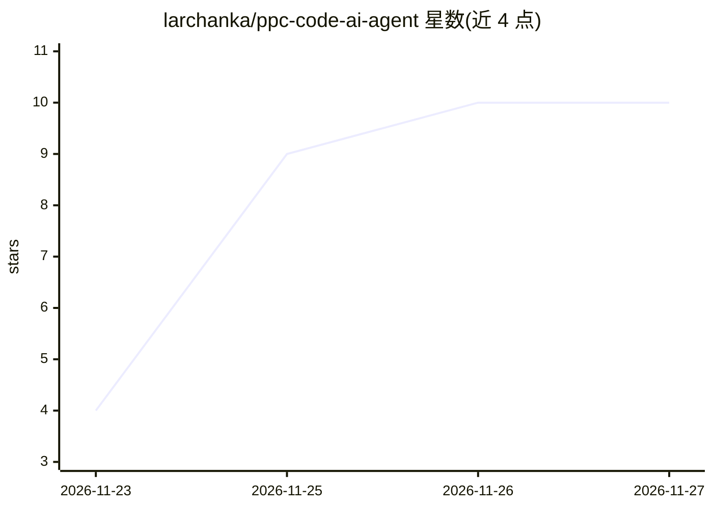

# larchanka/ppc-code-ai-agent

⭐ 10 · Perl · MIT · 推送 2026-11-26 · [GitHub](https://github.com/larchanka/ppc-code-ai-agent) · [官网](https://mobila.name) · 个人维护

**PowerPC 老款 Mac 上的终端 AI 编码代理**

面向运行 Mac OS X 10.4 Tiger 的 PowerPC Macintosh 的自包含交互式终端 AI 编码代理：纯 Perl 标准库实现，零 CPAN 依赖，可直接运行于系统自带的 Perl 5.8.6；内置静态链接的现代 TLS curl 二进制与证书包，解决老系统无法访问现代 HTTPS API 的问题。代理可读取/写入/编辑文件、浏览目录、执行 shell 命令，支持子代理委派（plan 只读/build 实现，50 轮上限）、手动/自动安全模式、会话管理与 slash 命令。

## 筛选速览

| 维度 | 判定 | 备注 |
|---|---|---|
| AI 角色 | `ai-native` | 本体是模型或模型工具 |
| 许可风险 | `permissive` | MIT |
| 部署形态 | `None` |  |
| 模型依赖 | local-ok | 支持本地模型 |
| 硬件要求 | — | 无带数字的原话,不猜 |
| 安装摩擦 | `low` | 无编译、无系统依赖或容器化 |
| 成熟度 | — | 结构信号不足 |

## 能力要点

- 零 CPAN 依赖，原生运行于系统自带 Perl 5.8.6
- 捆绑静态链接 PowerPC curl，支持 TLS 1.2/1.3
- 多模型接入：Anthropic Claude / Google Gemini / 本地 OpenAI 兼容端点
- 子代理委派与上下文隔离（plan/build 角色，50 轮上限）

## 适用场景

- 在老款 iBook/PowerBook 上用 Claude 或 Gemini 读写代码、执行命令
- 通过局域网 Ollama/llama.cpp 离线使用本地模型做编码辅助
- 在 Tiger 系统上让代理自主检查目录、修改文件、运行测试

## 场景标签

`编码 Agent` · 领域:编码与开发

## 证据(README 行号)

> L28: **Code Agent** is a self-contained, interactive terminal AI agent created specifically for vintage PowerPC Macintos
> L36: - **Multi-Provider AI**: Connects to **Anthropic Claude**, **Google Gemini** (with a free tier requiring no credit 
> L37: - **Agentic Tool Execution**: Autonomously inspects directories, reads files, writes code, and executes shell comma

## 星数曲线

2026-11-23 4 → 2026-11-27 10（+6）

---
*卡片 v1 · prompt 1.4 · 生成 2026-11-23 · 置信度 high · 依据 README sha `372058d7040d` · [字段定义](../../DATASET.md)*
