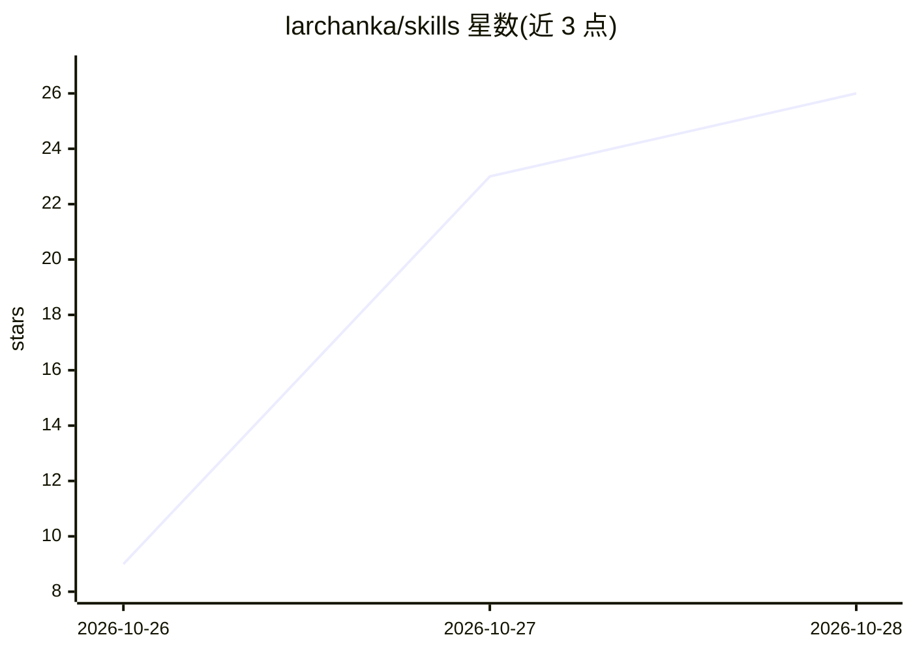

# larchanka/skills

⭐ 28 · Python · MIT · 推送 2026-10-26 · [GitHub](https://github.com/larchanka/skills) · [官网](https://larchanka.com) · 个人维护

**面向软件开发的 10 个独立 AI agent 技能集合**

收录 10 个各自独立、含自身文档的 agent 技能项目，覆盖软件开发与自动化场景：多 agent 规划-开发-评审-发布循环、五维度代码评审框架、基于 Tree-sitter 的代码库上下文生成、Chrome DevTools MCP 浏览器自动化、任务分解、项目变更调查、GitHub PR 创建、Slack 脚本化操作、TDD 参考与 YouTube 随机评论抽取。各技能以 SKILL.md 形式提供文档，可单独克隆使用。

## 筛选速览

| 维度 | 判定 | 备注 |
|---|---|---|
| AI 角色 | `ai-knowledge` | 知识聚合/清单类 |
| 许可风险 | `permissive` | MIT |
| 部署形态 | `None` |  |
| 模型依赖 | — | README 未给出锁定关系 |
| 硬件要求 | — | 无带数字的原话,不猜 |
| 安装摩擦 | `low` | 无编译、无系统依赖或容器化 |
| 成熟度 | — | 结构信号不足 |

## 能力要点

- 10 个独立技能，各含 SKILL.md 文档与安装说明
- agent-loop 协调规划/开发/评审/发布子 agent，协调者不写实现代码
- codebase-context-generator 用 Tree-sitter AST 生成 AGENTS.md 与结构化文档
- slack-cli 所有 Slack 操作经审批的 Python 脚本执行

## 适用场景

- 让 AI agent 按测试先行流程实现并发布功能
- 对代码变更做多维度评审或生成代码库上下文文档
- 通过 Chrome DevTools MCP 做浏览器端到端测试

## 场景标签

`多智能体` `浏览器自动化` `代码审查` · 领域:Agent 开发

## 证据(README 行号)

> L3: This repository is a collection of independent skills and tools for software development and automation. Each skill 
> L7: ### 1. agent-loop
> L70: Each skill is standalone - clone or use the specific skill you need. See the individual `SKILL.md` files for detail

## 星数曲线

2026-10-26 9 → 2026-10-28 26（+17）

---
*卡片 v1 · prompt 1.4 · 生成 2026-10-27 · 置信度 high · 依据 README sha `b596cc28a8d4` · [字段定义](../../DATASET.md)*
