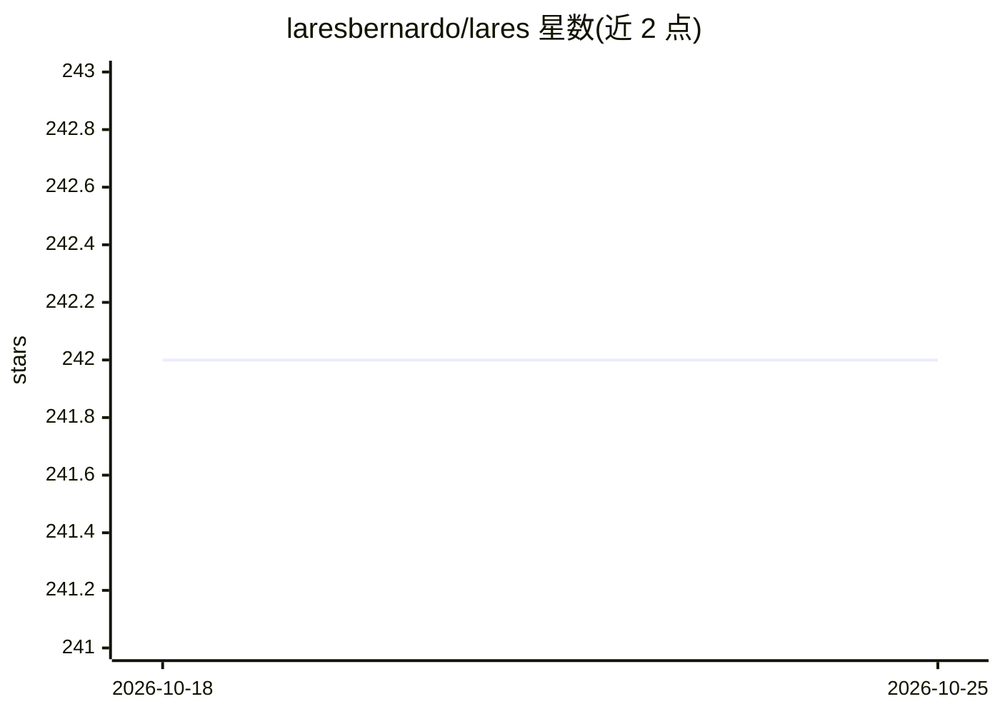

# laresbernardo/lares

⭐ 242 · R · NOASSERTION · 推送 2026-10-05 · [GitHub](https://github.com/laresbernardo/lares) · [官网](https://laresbernardo.github.io/lares/) · 个人维护

**R 分析师的机器学习与日常分析自动化工具包**

面向数据分析人员的 R 包，将日常分析与机器学习任务封装为函数族：AutoML 流水线（基于 h2o_automl() 做自动训练、模型选择与可视化）、数据清洗与探索性分析、分类/回归结果绘图、MMM 营销组合建模报告、API 集成与抓取器（含 Meta Marketing API、OpenAI 结构化提示词）、时间序列与投资组合分析、加密凭据管理及 NLP 工具。通过 CRAN 安装，开发版需 Windows 用户安装 RTools；另附 robyn_* 辅助函数与缓存机制加速工作流。

## 筛选速览

| 维度 | 判定 | 备注 |
|---|---|---|
| AI 角色 | `ai-ecosystem` | LLM/agent 周边工具 |
| 许可风险 | `none` | NOASSERTION |
| 部署形态 | `None` |  |
| 模型依赖 | — | README 未给出锁定关系 |
| 硬件要求 | — | 无带数字的原话,不猜 |
| 安装摩擦 | `low` | 无编译、无系统依赖或容器化 |
| 成熟度 | — | 结构信号不足 |

## 能力要点

- h2o_automl() 自动化机器学习流水线与模型结果可视化
- freqs()/distr()/corr_cross() 等即时数据摘要与关系探索函数
- gpt_* 结构化提示词构建与 OpenAI API 交互
- read_encrypted()/write_encrypted() 加密文件凭据管理

## 适用场景

- 快速跑通 AutoML 建模并可视化模型结果
- 做营销组合建模（MMM）的候选模型选择与报告
- 管理分析流水线中的 API 凭据与密钥

## 场景标签

`数据分析` · 领域:效率与自动化

## 证据(README 行号)

> L6: **lares** is an R package designed to automate, improve, and accelerate everyday **analytics and machine learning** 
> L44: - `h2o_automl()`, `mplot_full()` – Automated machine learning pipeline with optimal model selection and visualizati

## 星数曲线

2026-10-18 242 → 2026-10-25 242（+0）

---
*卡片 v1 · prompt 1.4 · 生成 2026-10-22 · 置信度 high · 依据 README sha `751df8c31dbd` · [字段定义](../../DATASET.md)*
