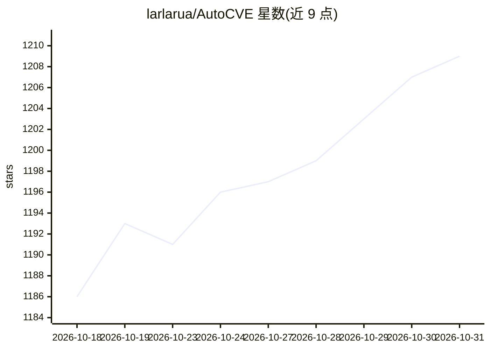

# larlarua/AutoCVE

⭐ 1,209 · Python · AGPL-3.0 · 推送 2026-10-01 · [GitHub](https://github.com/larlarua/AutoCVE) · 个人维护 · 中文 README

**面向安全研究者的自动化 CVE 挖掘多 Agent 平台**

基于 FastAPI/React/PostgreSQL 的源码审计平台：由 Orchestrator 调度 Recon、Scan、Triage、Finding、Verification 等 Agent，完成项目筛选、仓库导入、工具扫描、误报过滤、源码深挖、动态验证与 CVE 申报报告生成；Finding Agent 采用 ReAct Loop、工具调用、Nudge 纠偏与结构化终止机制，支持三种审计模式与交互式追问、Skills 扩展。通过 docker compose 一行命令部署，AGPL-3.0，仅限授权安全研究使用。README 展示一周测试提交 30 个 CVE 的成果。

## 筛选速览

| 维度 | 判定 | 备注 |
|---|---|---|
| AI 角色 | `ai-native` | 本体是模型或模型工具 |
| 许可风险 | `viral` | AGPL-3.0 |
| 部署形态 | `desktop` | 安装包/桌面程序 |
| 模型依赖 | — | README 未给出锁定关系 |
| 硬件要求 | — | 无带数字的原话,不猜 |
| 安装摩擦 | `low` | 无编译、无系统依赖或容器化 |
| 成熟度 | `idea` | |

## 能力要点

- Orchestrator 调度多 Agent 完成 Recon/Scan/Triage/Finding/Verification 全流程
- Finding Agent 采用 ReAct Loop、Nudge 纠偏与 FinalizeFinding 结构化终止
- 增强扫描/智能审计/综合审计三种模式
- 可视化审计追踪与交互式追问、Skills 扩展

## 适用场景

- 我需要对授权的开源项目做源码审计并产出 CVE 申报报告
- 我想让 Agent 自动过滤扫描误报并动态验证漏洞
- 我想围绕审计结果继续追问补充攻击链与复现步骤

## 场景标签

`多智能体` `网络安全` · 领域:Agent 开发

## 证据(README 行号)

> L42: 通过 Orchestrator 统一调度 Recon、Scan、Triage、Finding 和 Verification 等 Agent，协同完成信息收集、工具扫描、误报过滤、漏洞深挖与动态验证。
> L63: Finding Agent 是 AutoCVE 的核心审计能力，专为 CVE 挖掘场景设计。它可直接分析项目源码，并结合 ReAct Loop、专项工具调用、Nudge 纠偏及 `FinalizeFinding` 结构化终止机制，
> L126: > AutoCVE 在为期一周的测试中，共发现并提交了 **30 个安全漏洞**，覆盖 **14 个开源项目**。

## 星数曲线

2026-10-18 1,186 → 2026-10-31 1,209（+23）

---
*卡片 v1 · prompt 1.4 · 生成 2026-10-21 · 置信度 high · 依据 README sha `13e8f2637a77` · [字段定义](../../DATASET.md)*
