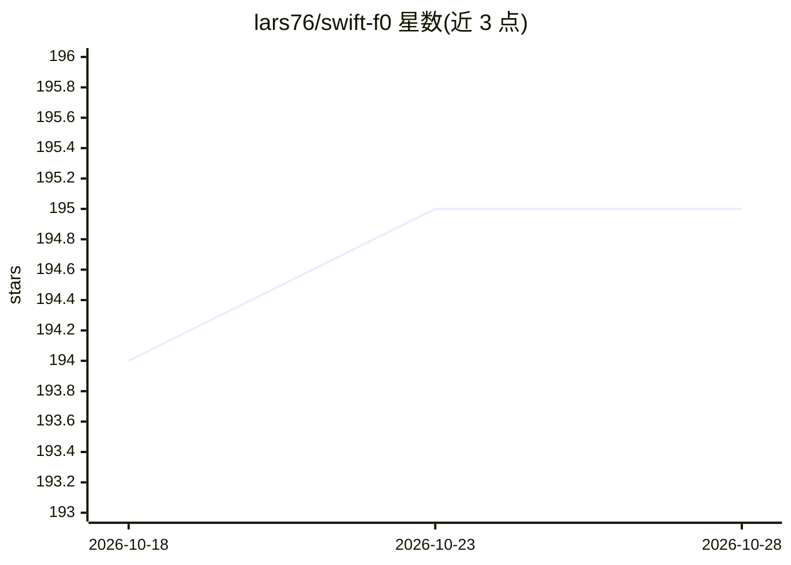

# lars76/swift-f0

⭐ 195 · Python · MIT · 推送 2026-09-25 · [GitHub](https://github.com/lars76/swift-f0) · 个人维护

**给音频开发者的单音基频（F0）检测库：CNN 从频谱图读音高**

面向音频/语音开发者的 Python 音高检测库：内置 14,386 参数的小型卷积神经网络，从 16 kHz 音频的频谱图中逐帧输出音高、置信度与响度。支持单次检测、文件检测（WAV/FLAC/OGG/MP3 等）与 176 ms 前瞻的流式处理，CPU 单核约 180 倍实时。附音符切分、MIDI 导出、CSV 导出与绘图。检测范围 46.875–2093.75 Hz，仅适用于单声道单音源（不含和弦）；模型不做电平归一化，过轻录音需先放大。另提供 ONNX Runtime Web 的浏览器端演示。

## 筛选速览

| 维度 | 判定 | 备注 |
|---|---|---|
| AI 角色 | `ai-native` | 本体是模型或模型工具 |
| 许可风险 | `permissive` | MIT |
| 部署形态 | `library` | 以包/库形式分发 |
| 模型依赖 | — | README 未给出锁定关系 |
| 硬件要求 | — | 无带数字的原话,不猜 |
| 安装摩擦 | `low` | 无编译、无系统依赖或容器化 |
| 成熟度 | — | 结构信号不足 |

## 能力要点

- 14,386 参数 CNN，CPU 单核约 180 倍实时
- 流式接口支持实时音频（176 ms 前瞻）
- 音符切分、MIDI/CSV 导出与绘图
- 逐帧置信度与响度输出，支持多声道混合与自动重采样

## 适用场景

- 从语音或乐器录音中提取音高曲线
- 实时音频流的音高追踪
- 把旋律转成 MIDI 音符

## 场景标签

 · 领域:音频/语音处理

## 证据(README 行号)

> L9: **SwiftF0** is a fast and accurate pitch detector for monophonic audio (one voice or instrument, not chords). A smal
> L11: In the Pitch Detection Benchmark, SwiftF0 has the highest pitch F1 of the 19 trackers tested, statistically tied wi

## 星数曲线

2026-10-18 194 → 2026-10-28 195（+1）

---
*卡片 v1 · prompt 1.4 · 生成 2026-10-22 · 置信度 high · 依据 README sha `f0d20d64ab41` · [字段定义](../../DATASET.md)*
