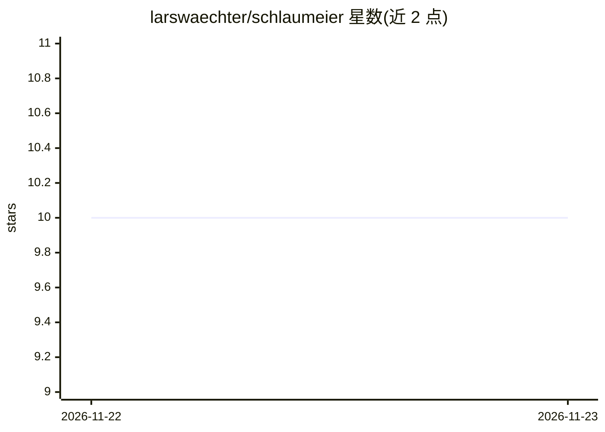

# larswaechter/schlaumeier

⭐ 10 · Python · MIT · 推送 2026-11-06 · [GitHub](https://github.com/larswaechter/schlaumeier) · 个人维护

**用 LLM+ADB 自动解答 Android 答题游戏的机器人**

Python 编写的机器人，通过 ADB 截取 Android 手机屏幕，用 OpenCV+Tesseract 切片提取题目与选项（或直接把截图交给视觉模型），送入 LLM 得出答案字母后以触摸事件自动点选。支持 Claude Code skill 模式（无 API key、无 OCR 配置）与 Python 脚本模式，后端可选 OpenAI、Anthropic、Ollama 本地模型或任意 OpenAI 兼容 API。作者声明仅供研究用途，多数游戏禁止此类工具，答案不保证正确，非完全自主、需部分用户交互。

## 筛选速览

| 维度 | 判定 | 备注 |
|---|---|---|
| AI 角色 | `ai-native` | 本体是模型或模型工具 |
| 许可风险 | `permissive` | MIT |
| 部署形态 | `self-host` | docker 或自建部署 |
| 模型依赖 | local-ok | 支持本地模型 |
| 硬件要求 | — | 无带数字的原话,不猜 |
| 安装摩擦 | `low` | 无编译、无系统依赖或容器化 |
| 成熟度 | — | 结构信号不足 |

## 能力要点

- ADB 截屏→切片→LLM→自动点选的完整答题流水线
- SCREEN_READER=vision 模式直接将截图送视觉模型
- LLM 后端可切换：OpenAI/Anthropic/Ollama 本地/OpenAI 兼容 API
- 附带 Claude Code /schlauleier skill，经 MCP 仅暴露截图与点击两个工具

## 适用场景

- 自动玩 QuizDuel、Quiz Planet 等问答游戏
- 换用本地模型让答题数据不离开本机
- 作为 fork 基础适配其他选择题型问答游戏

## 场景标签

`OCR` `GUI 自动化` · 领域:效率与自动化

## 证据(README 行号)

> L7: _schlaumeier_ is a bot written in Python that allows you to automatically solve Android quiz games like QuizDuel, Qu
> L14: Simply put, the script operates by creating a screenshot, extracting the question / answers and passing them to an 
> L69: - For the Python script: an LLM, like a ChatGPT API Key, Claude API Key, Ollama or any OpenAI compatible API

## 星数曲线

2026-11-22 10 → 2026-11-23 10（+0）

---
*卡片 v1 · prompt 1.4 · 生成 2026-11-22 · 置信度 high · 依据 README sha `0e23b6efff78` · [字段定义](../../DATASET.md)*
