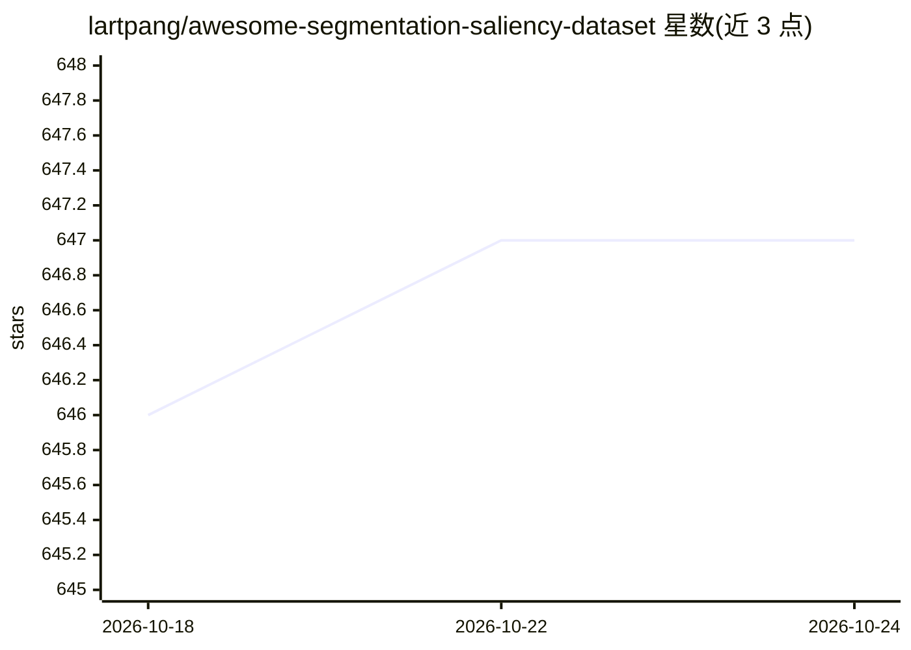

# lartpang/awesome-segmentation-saliency-dataset

⭐ 647 · MIT · 推送 2026-09-15 · [GitHub](https://github.com/lartpang/awesome-segmentation-saliency-dataset) · [官网](https://lartpang.github.io/awesome-segmentation-saliency-dataset/README.html) · 个人维护 · 中文 README

**图像分割与显著性检测数据集的策展清单**

lartpang 维护的数据集聚合清单，按 RGB 显著性等类别组织分割/显著性检测领域数据集（MSRA10K、SED1/2、ASD、DUT-OMRON、DUTS 等）。每个条目提供论文、项目页与下载链接，并附数据集原始论文的中英双语介绍（规模、标注方式、图像来源等），另在 issue 中补充未收录数据集。清单以 MIT 许可发布，面向计算机视觉研究者查找训练/评测数据。

## 筛选速览

| 维度 | 判定 | 备注 |
|---|---|---|
| AI 角色 | `ai-knowledge` | 知识聚合/清单类 |
| 许可风险 | `permissive` | MIT |
| 部署形态 | `desktop` | 安装包/桌面程序 |
| 模型依赖 | — | README 未给出锁定关系 |
| 硬件要求 | — | 无带数字的原话,不猜 |
| 安装摩擦 | `low` | 无编译、无系统依赖或容器化 |
| 成熟度 | — | 结构信号不足 |

## 能力要点

- 按显著性检测/分割任务分类组织数据集条目
- 每条目含论文、项目页与下载链接
- 附数据集论文的中文介绍（规模、标注协议）
- issue #15 补充收录其他数据集

## 适用场景

- 为显著性检测模型寻找训练与测试数据集
- 比较各数据集的规模与标注方式
- 查找数据集论文原文与下载入口

## 场景标签

`精选清单` · 领域:学习与行业

## 证据(README 行号)

> L1: # Another Awesome Dataset List Badge
> L18: ## Saliency

## 星数曲线

2026-10-18 646 → 2026-10-24 647（+1）

---
*卡片 v1 · prompt 1.4 · 生成 2026-10-21 · 置信度 high · 依据 README sha `382e61744f35` · [字段定义](../../DATASET.md)*
