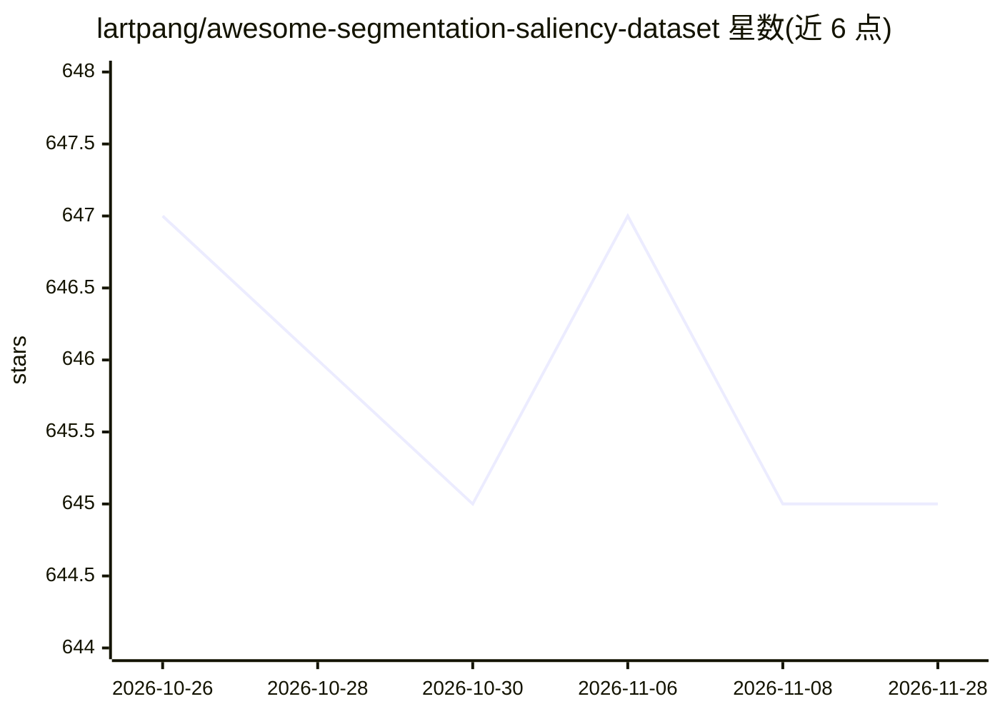

# lartpang/awesome-segmentation-saliency-dataset

⭐ 645 · MIT · 推送 2026-11-25 · [GitHub](https://github.com/lartpang/awesome-segmentation-saliency-dataset) · [官网](https://lartpang.github.io/awesome-segmentation-saliency-dataset/README.html) · 个人维护 · 中文 README

**为显著性检测/分割研究者整理的数据集清单**

以 README 形式维护的数据集汇总清单，按显著性检测（RGB Saliency 等类别）组织条目，每个数据集收录论文出处、项目主页、下载链接及规模/标注说明，并附中英文双语介绍。作者在 issue 中另行列出更多数据集，并提示使用数据集时引用对应论文。仓库本身不包含代码或工具，仅作为数据集索引，许可证为 MIT。

## 筛选速览

| 维度 | 判定 | 备注 |
|---|---|---|
| AI 角色 | `ai-knowledge` | 知识聚合/清单类 |
| 许可风险 | `permissive` | MIT |
| 部署形态 | `desktop` | 安装包/桌面程序 |
| 模型依赖 | — | README 未给出锁定关系 |
| 硬件要求 | — | 无带数字的原话,不猜 |
| 安装摩擦 | `low` | 无编译、无系统依赖或容器化 |
| 成熟度 | — | 结构信号不足 |

## 能力要点

- 按显著性检测等类别组织的数据集条目
- 每个条目含论文、项目页、下载地址与规模/标注描述
- 条目附中英双语介绍
- issue 中维护补充数据集列表

## 适用场景

- 为显著性检测研究挑选训练/评测数据集
- 查找某个经典数据集的原始论文与下载入口
- 复现论文时确认数据集规模与标注形式

## 场景标签

`精选清单` · 领域:学习与行业

## 证据(README 行号)

> L18: ## Saliency
> L20: ### RGB Saliency
> L22: #### MSRA(MSRA10K/MSRA-B)

## 星数曲线

2026-10-26 647 → 2026-11-28 645（-2）

---
*卡片 v1 · prompt 1.4 · 生成 2026-11-26 · 置信度 high · 依据 README sha `e8be2334d766` · [字段定义](../../DATASET.md)*
