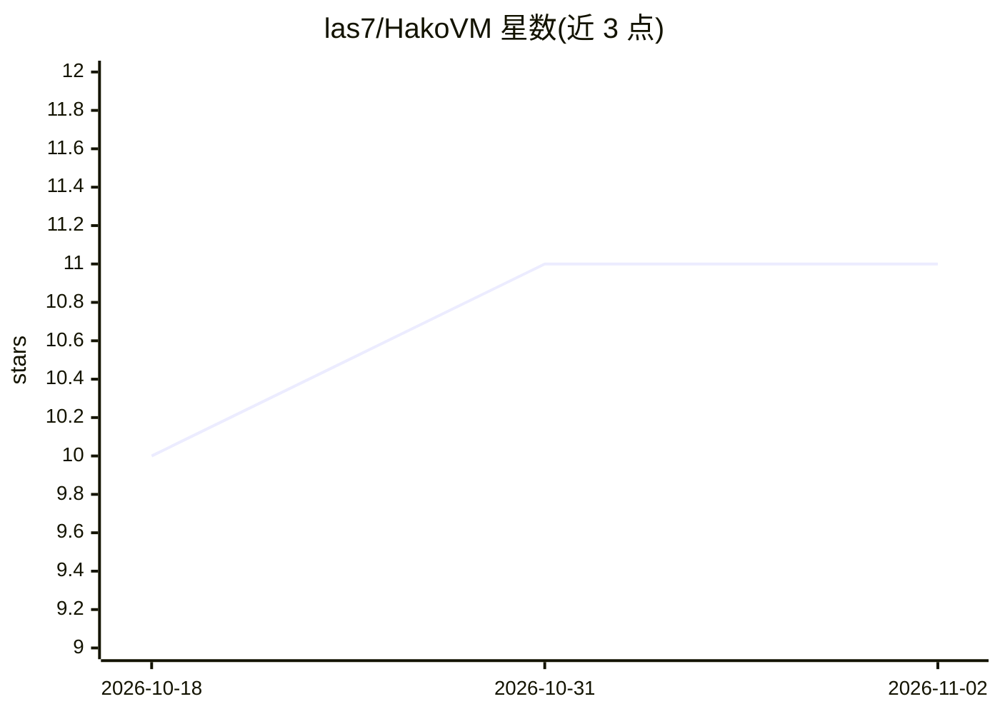

# las7/HakoVM

⭐ 11 · Swift · Apache-2.0 · 推送 2026-09-06 · [GitHub](https://github.com/las7/HakoVM) · 个人维护

**macOS 上为 AI agent 提供的一次性 microVM 沙箱运行时**

基于 Apple Containerization 框架、以 Swift 编写的单二进制 microVM 运行时：从任意 OCI 镜像约 300 ms 启动硬件隔离的 Linux 虚拟机，通过 vsock 执行命令并回传 stdout/stderr/退出码，用完即弃。默认无网卡、无守护进程、无需 root，宿主访问仅限声明的 virtiofs 挂载。面向让 AI agent 安全执行不受信代码与命令的开发者，提供 CLI、MCP server、Claude Code hook 与 JSON 输出四条接入路径，支持 commit/fork 镜像做依赖缓存。要求 Apple Silicon 与 macOS 26 及以上。

## 筛选速览

| 维度 | 判定 | 备注 |
|---|---|---|
| AI 角色 | `ai-ecosystem` | LLM/agent 周边工具 |
| 许可风险 | `permissive` | Apache-2.0 |
| 部署形态 | `library` | 以包/库形式分发 |
| 模型依赖 | locked-api |  |
| 硬件要求 | — | 无带数字的原话,不猜 |
| 安装摩擦 | `medium` | 含编译或系统依赖之一 |
| 成熟度 | — | 结构信号不足 |

## 能力要点

- 约 300 ms 从 OCI 镜像启动一次性 Linux microVM，单条命令执行约 8 ms
- 默认无 NIC、无守护进程、无需 root，仅挂载声明的宿主目录
- 支持镜像 commit/copy-on-write clone 做依赖预装与多 agent 并行启动
- 提供 CLI JSON、MCP server、Claude Code hook 等 agent 接入路径

## 适用场景

- 让 coding agent 的每条 Bash 命令在隔离 VM 中执行
- 作为代码解释器运行模型生成的代码并取回结果
- 通过 MCP 把 hako 注册为模型可调用的沙箱执行工具

## 场景标签

 · 领域:AI agent 基础设施/虚拟化

## 证据(README 行号)

> L3:  Firecracker-class microVMs for macOS. Built for AI agents.
> L43: for one job: giving an AI agent a disposable machine it cannot escape from.
> L65: - **Boots a Linux microVM** from any OCI image via Virtualization.framework.

## 星数曲线

2026-10-18 10 → 2026-11-02 11（+1）

---
*卡片 v1 · prompt 1.4 · 生成 2026-11-02 · 置信度 mid · 依据 README sha `630decb7e701` · [字段定义](../../DATASET.md)*
