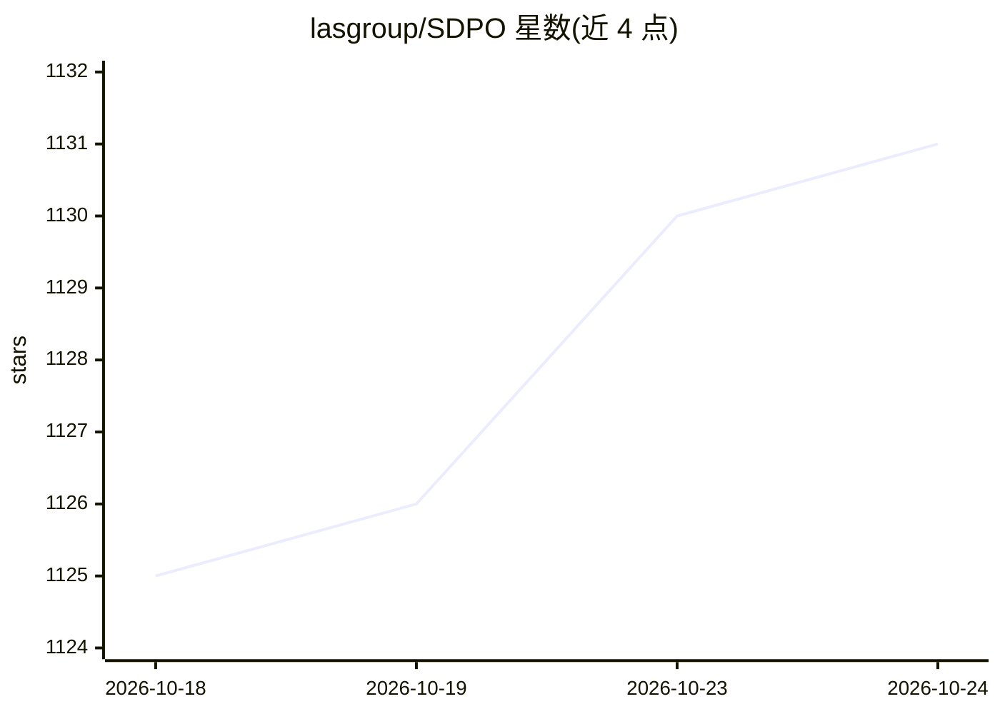

# lasgroup/SDPO

⭐ 1,131 · Python · Apache-2.0 · 推送 2026-07-01 · [GitHub](https://github.com/lasgroup/SDPO) · [官网](https://self-distillation.github.io/SDPO) · 组织维护

**自蒸馏强化学习训练框架：用模型自身高奖励轨迹做策略优化**

SDPO（Self-Distilled Policy Optimization）是论文配套的 LLM 强化学习后训练代码，基于 verl 框架实现：将当前模型在反馈条件下的下一 token 预测作为自教师，蒸馏回策略，把文本反馈转化为稠密学习信号，无需外部教师或显式奖励模型。支持有/无丰富环境反馈两种设定与测试时自蒸馏，提供 GRPO 基线复现脚本、数据预处理流程与 Docker（GH200）方案。要求 Linux、NVIDIA GPU 与 Python 3.12，Blackwell 架构未完整测试。

## 筛选速览

| 维度 | 判定 | 备注 |
|---|---|---|
| AI 角色 | `ai-native` | 本体是模型或模型工具 |
| 许可风险 | `permissive` | Apache-2.0 |
| 部署形态 | `self-host` | docker 或自建部署 |
| 模型依赖 | local-ok | 支持本地模型 |
| 硬件要求 | — | 无带数字的原话,不猜 |
| 安装摩擦 | `low` | 无编译、无系统依赖或容器化 |
| 成熟度 | — | 结构信号不足 |

## 能力要点

- 反馈条件下的自教师机制，无需外部教师或显式奖励模型
- 支持有/无丰富环境反馈两种训练设定及 GRPO 基线复现脚本
- 测试时自蒸馏：推理阶段迭代精炼输出，无需额外训练
- 基于 verl 框架，提供完整配置项（KL 系数、top-k 蒸馏、重提示模板等）

## 适用场景

- 复现论文中 SDPO 与 GRPO 的对比实验
- 在数学/代码/化学等可验证任务上做 LLM 后训练
- 在反馈稀疏环境下利用高奖励 rollout 做稠密监督训练

## 场景标签

`强化学习` · 领域:训练与推理

## 证据(README 行号)

> L18: **We propose Self-Distilled Policy Optimization (SDPO)**, a reinforcement learning framework that augments on-polic
> L20: SDPO converts tokenized feedback into a dense learning signal without any external teacher or explicit reward model
> L240: This section documents the configuration options added by SDPO on top of the base verl framework.

## 星数曲线

2026-10-18 1,125 → 2026-10-24 1,131（+6）

---
*卡片 v1 · prompt 1.4 · 生成 2026-10-21 · 置信度 high · 依据 README sha `1c0acfa48b87` · [字段定义](../../DATASET.md)*
