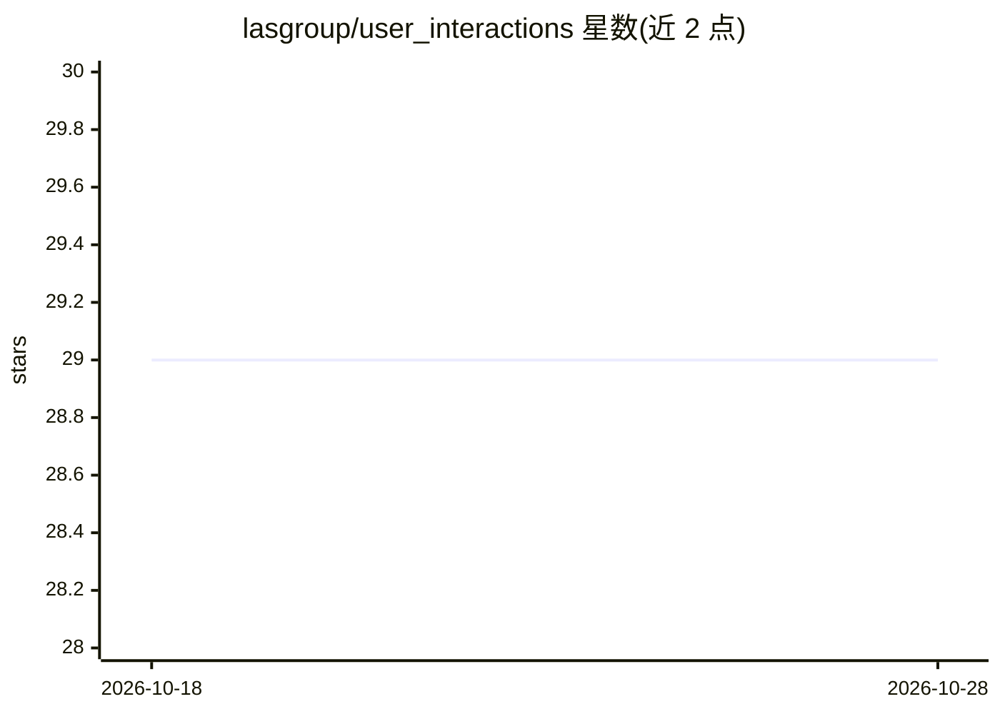

# lasgroup/user_interactions

⭐ 29 · Python · Apache-2.0 · 推送 2026-03-31 · [GitHub](https://github.com/lasgroup/user_interactions) · [官网](https://self-distillation.github.io/user_interactions) · 组织维护

**SDPO：通过用户交互自蒸馏对齐语言模型的训练与评测代码**

论文《Aligning Language Models from User Interactions》的官方代码库，实现 Self-Distillation Policy Optimization（SDPO）：策略模型生成回答后，用户模拟器给出后续反馈，用逐 token log 比率作为优势信号更新策略，无需显式奖励模型或偏好标注。支持在线 SDPO（本地 Qwen 或 API 的 Claude 用户模拟器）与离线 SDPO（WildFeedback/WildChat 等既有交互数据，经 accelerate 多 GPU 训练）。提供 HelpSteer2、TL;DR 等数据预处理脚本、checkpoint 评测、in-context oracle 基线与逐 token 信号可视化热图。面向做 LLM 对齐与个性化研究的人员。

## 筛选速览

| 维度 | 判定 | 备注 |
|---|---|---|
| AI 角色 | `ai-ecosystem` | LLM/agent 周边工具 |
| 许可风险 | `permissive` | Apache-2.0 |
| 部署形态 | `library` | 以包/库形式分发 |
| 模型依赖 | local-ok | 支持本地模型 |
| 硬件要求 | — | 无带数字的原话,不猜 |
| 安装摩擦 | `low` | 无编译、无系统依赖或容器化 |
| 成熟度 | — | 结构信号不足 |

## 能力要点

- 逐 token log-ratio 优势信号，无需奖励模型或偏好标签
- 在线与离线两种训练设定，支持 Claude API 用户模拟器
- 数据预处理、checkpoint 评测与 in-context oracle 基线脚本
- SDPO 信号可视化（相关/无关 follow-up 热图对比）

## 适用场景

- 复现论文中基于用户交互的 LLM 对齐实验
- 在 WildFeedback / WildChat 等交互数据上离线训练个性化模型
- 分析用户反馈信号在 token 级别的结构

## 场景标签

`强化学习` `模型评测` · 领域:评测与运维

## 证据(README 行号)

> L3: This repository contains the training and evaluation code for **Self-Distillation Policy Optimization (SDPO) from Us
> L5: The core idea: at each step the policy generates a response `y` to a prompt `x`, a user simulator produces a follow-
> L9: - **Online SDPO** — the policy generates responses on-the-fly; the signal is computed immediately against the curren

## 星数曲线

2026-10-18 29 → 2026-10-28 29（+0）

---
*卡片 v1 · prompt 1.4 · 生成 2026-10-26 · 置信度 high · 依据 README sha `5c77378b4290` · [字段定义](../../DATASET.md)*
