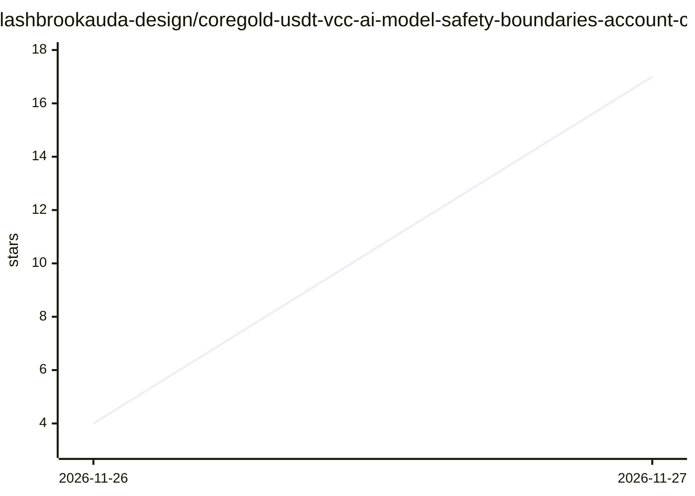

# lashbrookauda-design/coregold-usdt-vcc-ai-model-safety-boundaries-account-compliance-guide

⭐ 17 · 推送 2026-11-25 · [GitHub](https://github.com/lashbrookauda-design/coregold-usdt-vcc-ai-model-safety-boundaries-account-compliance-guide) · [官网](https://app.coregold.io/signup?invite_code=ADvlj9b) · 个人维护 · 中文 README

**海外 AI 会员订阅者的 USDT 虚拟卡开卡与防风控指南**

一份面向订阅 ChatGPT、Claude 等海外 AI 会员的用户指南，内容围绕避免账号因支付异常被风控冻结：给出绑卡卡段选择、账单地址一致性、Apple Pay/Google Pay 背书、余额维护等 4 条要点，并提供注册 CoreGold 平台、USDT（TRC20）充值、选卡开卡、绑定数字钱包的分步操作流程。文中含 CoreGold 注册邀请链接，产品本体为教程/推广内容，无源码或可运行组件。

## 筛选速览

| 维度 | 判定 | 备注 |
|---|---|---|
| AI 角色 | `ai-enhanced` | 去掉 AI 部分产品仍成立 |
| 许可风险 | `none` | — |
| 部署形态 | `None` |  |
| 模型依赖 | — | README 未给出锁定关系 |
| 硬件要求 | — | 无带数字的原话,不猜 |
| 安装摩擦 | `low` | 无编译、无系统依赖或容器化 |
| 成熟度 | — | 结构信号不足 |

## 能力要点

- 4 条海外 AI 账号支付风控避坑要点（卡段 BIN、AVS、钱包背书、余额维护）
- CoreGold 注册、USDT TRC20 充值、开卡与绑卡的分步教程
- 全卡段支持绑定 Apple Pay / Google Pay 的操作说明

## 适用场景

- 订阅 ChatGPT/Claude 等海外 AI 会员时选择支付卡段
- 避免账号因跨境预付卡被支付网关判定高危而误封
- 通过 USDT 充值开立美区虚拟卡并绑定手机钱包

## 场景标签

`教程课程` · 领域:学习与行业

## 证据(README 行号)

> L2: 11 月 24 日最新报道曝光 OpenAI 与 Anthropic 内部员工正围绕下一代模型发布边界展开激烈讨论，平台审核机制也随之收紧——聊聊用户在订阅海外 AI 会员时，怎么避免账号因支付异常被误封。
> L9: ### 🔍 实战干货：保护海外 AI 账号不被“支付风控误杀”的 4 个要点
> L25: 访问 **CoreGold 官方平台**：https://app.coregold.io/signup?invite_code=ADvlj9b，使用常用邮箱注册并登录进入用户后台。

## 星数曲线

2026-11-26 4 → 2026-11-27 17（+13）

---
*卡片 v1 · prompt 1.4 · 生成 2026-11-26 · 置信度 high · 依据 README sha `8c1692541ece` · [字段定义](../../DATASET.md)*
