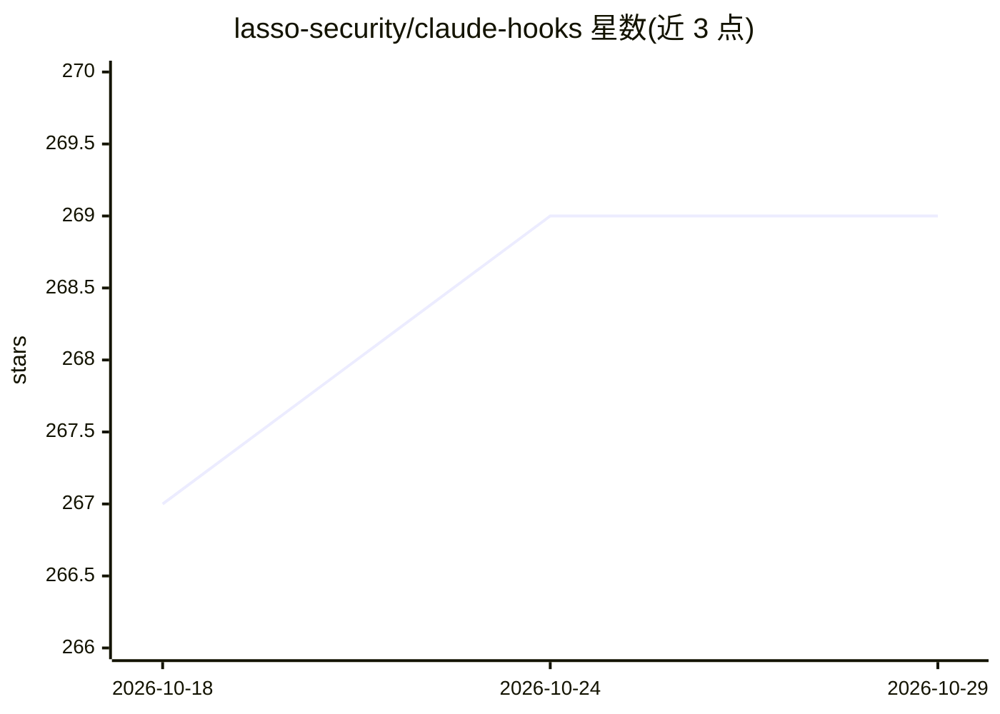

# lasso-security/claude-hooks

⭐ 269 · TypeScript · MIT · 推送 2026-01-08 · [GitHub](https://github.com/lasso-security/claude-hooks) · [官网](https://lasso.security) · 组织维护

**给 Claude Code 用户的间接提示注入防御钩子集合**

Lasso Security 维护的 Claude Code hooks 集合，核心为 Prompt Injection Defender：在 PostToolUse 时点扫描 Read/WebFetch/Bash/Grep/Task 及 MCP 工具输出，用 patterns.yaml 中的正则模式检测指令覆盖、角色扮演、编码混淆、上下文伪造等五类注入企图，向 Claude 发出警告（警告但不阻断）。基于模式匹配，无 API 调用、结果确定。安装方式包括通过 Claude 技能对话安装或 git clone 后运行 install.sh。附相关研究论文与 OWASP LLM Top 10 参考。

## 筛选速览

| 维度 | 判定 | 备注 |
|---|---|---|
| AI 角色 | `ai-ecosystem` | LLM/agent 周边工具 |
| 许可风险 | `permissive` | MIT |
| 部署形态 | `None` |  |
| 模型依赖 | — | README 未给出锁定关系 |
| 硬件要求 | — | 无带数字的原话,不猜 |
| 安装摩擦 | `low` | 无编译、无系统依赖或容器化 |
| 成熟度 | — | 结构信号不足 |

## 能力要点

- PostToolUse 钩子扫描 6 类工具输出（含 MCP 工具）
- 五类检测类别（指令覆盖/角色扮演/编码混淆/上下文操纵/指令走私）
- patterns.yaml 自定义正则模式与 high/medium/low 严重度分级
- 纯模式匹配，无 LLM API 调用、确定性输出

## 适用场景

- 在 Claude Code 读取网页或文件时防范隐藏的提示注入指令
- 为使用 MCP 服务器的 agent 会话增加工具输出安全扫描
- 按团队需求添加自定义注入检测模式

## 场景标签

`网络安全` · 领域:学习与行业

## 证据(README 行号)

> L4: A collection of security and utility hooks for Claude Code. Hooks allow you to extend Claude Code's behavior by runn
> L12: Defense against **indirect prompt injection** attacks. Scans tool outputs (files, web pages, command results) for i
> L170: |`mcp__*`|Any MCP server tool outputs|

## 星数曲线

2026-10-18 267 → 2026-10-29 269（+2）

---
*卡片 v1 · prompt 1.4 · 生成 2026-10-29 · 置信度 high · 依据 README sha `a242aef6e08a` · [字段定义](../../DATASET.md)*
