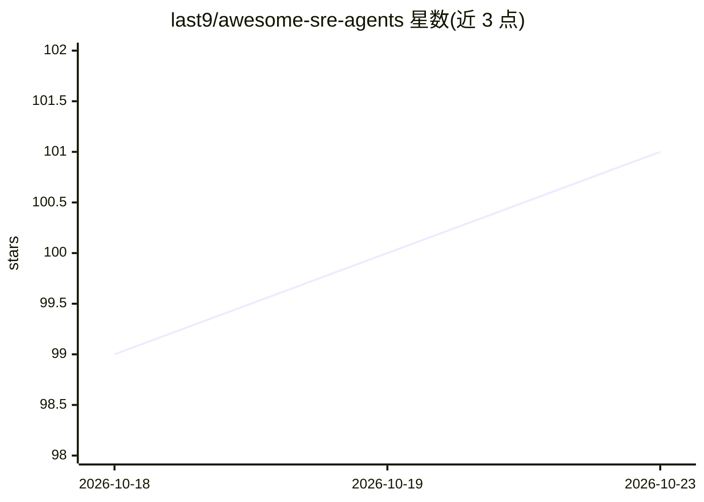

# last9/awesome-sre-agents

⭐ 101 · CC0-1.0 · 推送 2026-09-15 · [GitHub](https://github.com/last9/awesome-sre-agents) · [官网](https://last9.io) · 组织维护

**SRE/DevOps AI agent 策展清单：收录排障与运维代理工具**

由 last9 维护的 awesome 类型清单，收录用于站点可靠性工程（SRE）与 DevOps 的 AI 代理、平台与资源。内容按类别组织：agent 基准测试（SRE Bench）、事件响应代理（Beeps、incident.io 等）、代理构建平台（Obot、RunWhen 等）、SRE 代理（Holmes GPT、k8s-GPT 等），并单列已归档条目（IncidentFox）。条目以一句话功能描述标注，部分标注开源属性。给关注可靠性自动化选型的工程师与团队做发现与比较用。

## 筛选速览

| 维度 | 判定 | 备注 |
|---|---|---|
| AI 角色 | `ai-knowledge` | 知识聚合/清单类 |
| 许可风险 | `viral` | CC0-1.0 |
| 部署形态 | `None` |  |
| 模型依赖 | — | README 未给出锁定关系 |
| 硬件要求 | — | 无带数字的原话,不猜 |
| 安装摩擦 | `low` | 无编译、无系统依赖或容器化 |
| 成熟度 | — | 结构信号不足 |

## 能力要点

- 按基准测试/事件响应/平台/SRE 代理等类别组织条目
- 每条目附一句话功能说明并标注是否开源
- 单列 Archived 分区跟踪停止维护的条目

## 适用场景

- 为运维团队挑选事件响应或根因分析 agent
- 查找可构建/托管 SRE 代理的平台
- 了解 SRE 领域 agent 生态的覆盖范围

## 场景标签

`精选清单` · 领域:学习与行业

## 证据(README 行号)

> L1: # Awesome SRE Agents Awesome
> L3: AI agents that automate site reliability engineering and DevOps operations.

## 星数曲线

2026-10-18 99 → 2026-10-23 101（+2）

---
*卡片 v1 · prompt 1.4 · 生成 2026-10-23 · 置信度 high · 依据 README sha `146e7a662542` · [字段定义](../../DATASET.md)*
