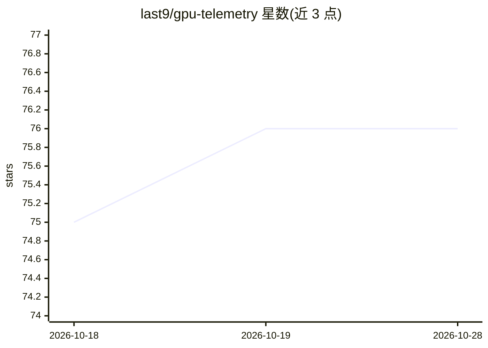

# last9/gpu-telemetry

⭐ 76 · Python · MIT · 推送 2026-10-26 · [GitHub](https://github.com/last9/gpu-telemetry) · [官网](https://last9.io/gpu-observability/) · 组织维护

**带工作负载归因的 GPU 遥测代理：把 GPU 指标关联到 K8s pod 或 Slurm 作业**

每个节点部署一个 agent（Python 包 l9gpu 或 Helm DaemonSet），采集 NVIDIA（NVML/DCGM）、AMD（amdsmi）、Intel Gaudi（hl-smi）的 GPU 指标，归一化为 OpenTelemetry 的 gpu.* 命名空间并以 OTLP 输出；配合 Go 编写的 k8sprocessor / slurmprocessor 两个 OTel Collector 处理器，为每个数据点附加 pod、namespace、deployment 或 Slurm job、user、account 等归属信息，实现按团队/作业/模型的用量核算。面向运行 GPU 集群（K8s 或 Slurm）的运维与平台团队。自带 Grafana 面板、17 条告警规则与 vLLM/SGLang/TGI/Triton/NIM 推理引擎监控。部分组件衍生自 Meta 的 facebookresearch/gcm 项目。

## 筛选速览

| 维度 | 判定 | 备注 |
|---|---|---|
| AI 角色 | `ai-ecosystem` | LLM/agent 周边工具 |
| 许可风险 | `permissive` | MIT |
| 部署形态 | `self-host` | docker 或自建部署 |
| 模型依赖 | — | README 未给出锁定关系 |
| 硬件要求 | — | 无带数字的原话,不猜 |
| 安装摩擦 | `low` | 无编译、无系统依赖或容器化 |
| 成熟度 | — | 结构信号不足 |

## 能力要点

- 每节点一个 agent 输出厂商中立的 OTLP 遥测
- K8s pod/namespace/deployment 与 Slurm job/user 的归因 enrichment
- 覆盖 NVIDIA、AMD MI300X/MI325X、Intel Gaudi 2/3 三类硬件
- 预置 Grafana 面板、17 条告警规则与 vLLM/SGLang/TGI/Triton/NIM 监控

## 适用场景

- 弄清集群中哪个 pod 或 Slurm 作业在消耗 GPU，支撑按团队/模型的成本核算
- 统一采集多厂商 GPU 的利用率、温度、ECC 等指标并接入任意 OTLP 后端
- 为 LLM 推理服务（vLLM/TGI 等）搭建 GPU 与推理引擎的可观测性

## 场景标签

`LLM 可观测性` `MLOps` · 领域:评测与运维

## 证据(README 行号)

> L17: `l9gpu` closes the loop. One agent per node emits vendor-neutral OTLP with
> L18: **workload attribution baked in** — Kubernetes pod, namespace, deployment;
> L78: Collectors on each node normalize NVML / DCGM / amdsmi / hl-smi into the

## 星数曲线

2026-10-18 75 → 2026-10-28 76（+1）

---
*卡片 v1 · prompt 1.4 · 生成 2026-10-24 · 置信度 high · 依据 README sha `533ceb3ef30f` · [字段定义](../../DATASET.md)*
