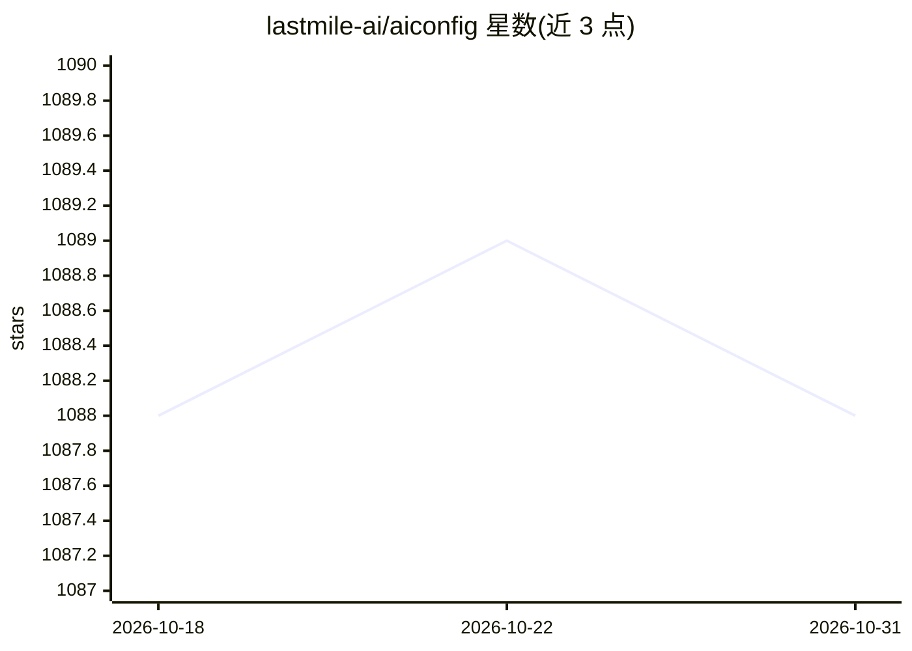

# lastmile-ai/aiconfig

⭐ 1,088 · Python · MIT · 推送 2026-02-10 · [GitHub](https://github.com/lastmile-ai/aiconfig) · [官网](https://aiconfig.lastmileai.dev) · 组织维护

**配置化框架：将生成式 AI 提示词与模型参数存为可版本控制的 JSON**

面向构建生产级生成式 AI 应用的开发者的框架：把 prompts、模型与模型参数存为 JSON 序列化配置，与应用代码分离，可版本控制、评测、监控，并在本地编辑器中快速迭代。提供 Python 与 Node SDK，设计为模型无关、多模态，开箱支持 OpenAI、Gemini、LLaMA、PaLM、Hugging Face 等模型，可通过 ModelParser 扩展其他模型与自定义端点。安装方式为 pip 或 poetry 安装 python-aiconfig，另有 VS Code 编辑器扩展。

## 筛选速览

| 维度 | 判定 | 备注 |
|---|---|---|
| AI 角色 | `ai-ecosystem` | LLM/agent 周边工具 |
| 许可风险 | `permissive` | MIT |
| 部署形态 | `library` | 以包/库形式分发 |
| 模型依赖 | locked-api |  |
| 硬件要求 | — | 无带数字的原话,不猜 |
| 安装摩擦 | `low` | 无编译、无系统依赖或容器化 |
| 成熟度 | — | 结构信号不足 |

## 能力要点

- prompts 与模型参数以 JSON 配置存储，可版本控制与评测
- 模型无关、多模态的 Python/Node SDK
- AIConfig Editor 可视化编辑提示词与模型参数
- 可通过 ModelParser 扩展任意模型与自定义端点

## 适用场景

- 在应用代码之外单独迭代提示词与模型参数
- 构建复杂 prompt 链与多模型工作流
- 让不同成员分别负责提示词与应用开发并共享 aiconfig 工件

## 场景标签

`提示工程` · 领域:Agent 开发

## 证据(README 行号)

> L12: AIConfig is a framework that makes it easy to build generative AI applications for production. It manages generativ
> L142: - **Model-agnostic and multimodal SDK**: Python & Node SDKs to use `aiconfig` in your application code. AIConfig i

## 星数曲线

2026-10-18 1,088 → 2026-10-31 1,088（+0）

---
*卡片 v1 · prompt 1.4 · 生成 2026-10-21 · 置信度 high · 依据 README sha `a0b650e2cf4f` · [字段定义](../../DATASET.md)*
