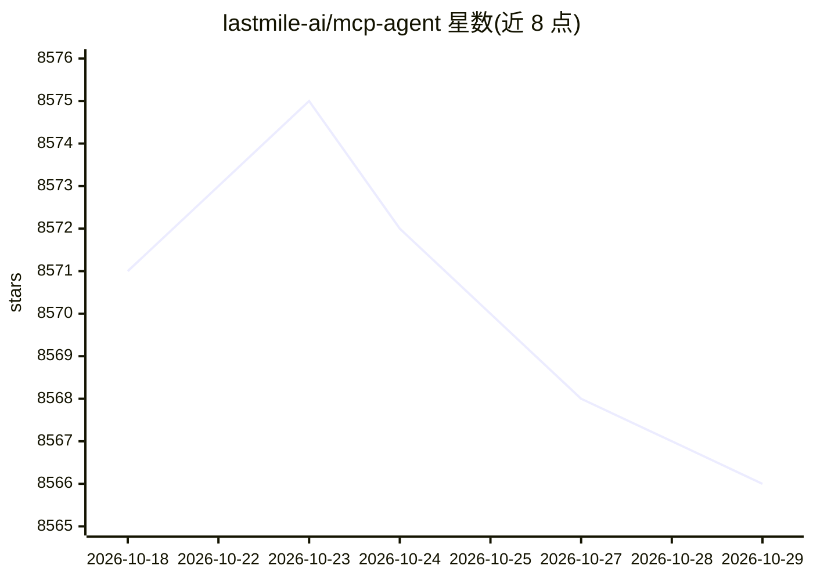

# lastmile-ai/mcp-agent

⭐ 8,566 · Python · Apache-2.0 · 推送 2026-01-25 · [GitHub](https://github.com/lastmile-ai/mcp-agent) · 组织维护

**基于 MCP 的 Python agent 构建框架：组合式工作流模式**

mcp-agent 是一个用于构建 agent 应用的 Python 框架，完整实现 Model Context Protocol（含 OAuth、Sampling、Elicitation 等高级特性），管理 MCP 服务器连接生命周期。以 Anthropic 的 Building Effective Agents 模式为基础，提供 Router、Map-Reduce、Orchestrator、Evaluator-Optimizer、Swarm 等可组合工作流工厂函数，Augmented LLM 层封装多提供商 SDK（OpenAI/Anthropic/Google/Azure/Bedrock 可选安装）。执行引擎可在 asyncio 与 Temporal 之间切换以获得持久化执行（暂停/恢复/重试/人工介入），并支持将应用暴露为 MCP 服务器、CLI 脚手架与云端部署。面向构建 agent 应用的开发者。

## 筛选速览

| 维度 | 判定 | 备注 |
|---|---|---|
| AI 角色 | `ai-ecosystem` | LLM/agent 周边工具 |
| 许可风险 | `permissive` | Apache-2.0 |
| 部署形态 | `library` | 以包/库形式分发 |
| 模型依赖 | locked-api |  |
| 硬件要求 | — | 无带数字的原话,不猜 |
| 安装摩擦 | `low` | 无编译、无系统依赖或容器化 |
| 成熟度 | — | 结构信号不足 |

## 能力要点

- 完整实现 MCP 协议（Tools/Resources/Prompts/OAuth/Sampling/Elicitation）
- Router、Orchestrator、Map-Reduce、Swarm 等可组合工作流模式
- Temporal 持久化执行：暂停/恢复/重试/人工审批无需改代码
- 可将 MCPApp 暴露为标准 MCP 服务器供 Claude Desktop、Cursor 调用

## 适用场景

- 构建连接多个 MCP 服务器（filesystem、fetch、Slack 等）的 agent
- 用组合式模式搭建多 agent 编排、路由或深度研究工作流
- 生产环境需要可暂停、可恢复的持久化 agent 执行

## 场景标签

`Agent 框架` `多智能体` · 领域:Agent 开发

## 证据(README 行号)

> L21: **`mcp-agent`** is a simple, composable framework to build effective agents using Model Context Protocol.
> L29: 2. **Effective agent patterns**: It implements every pattern described in Anthropic's Building Effective Agents in 
> L203: Augmented LLMs wrap provider SDKs with the agent’s tools, memory, and structured output helpers. Attach one to an 

## 星数曲线

2026-10-18 8,571 → 2026-10-29 8,566（-5）

---
*卡片 v1 · prompt 1.4 · 生成 2026-10-20 · 置信度 high · 依据 README sha `43b988458896` · [字段定义](../../DATASET.md)*
