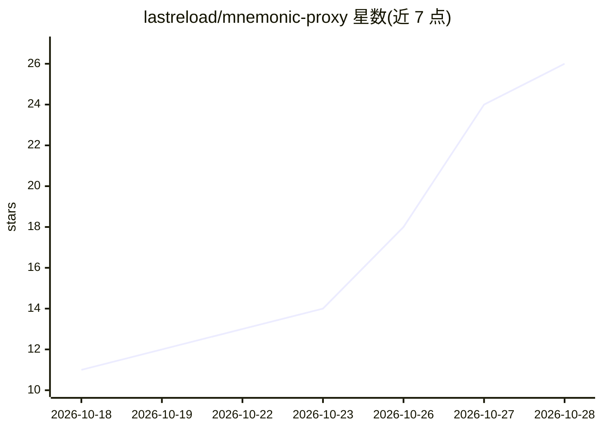

# lastreload/mnemonic-proxy

⭐ 26 · Python · MIT · 推送 2026-10-27 · [GitHub](https://github.com/lastreload/mnemonic-proxy) · [官网](https://lastreload.github.io/mnemonic-proxy/) · 组织维护

**代理层：管理编码 agent 上下文窗口，原文存档可召回**

透明 HTTP 代理，部署在编码 agent（Claude Code、Codex、pi 等）与本地模型服务（llama-server、Strata、ds4-server、Ollama 或任意 OpenAI 兼容后端）之间。agent 持续发送完整历史，代理通过遮蔽旧内容、原文磁盘存档、recall 工具精确检索、分段交接笔记、KV 状态保存与按需加载工具定义来控制实际进入提示窗的内容。要求引擎窗口至少 16K token（建议 32K+），Python ≥ 3.10 仅标准库。

## 筛选速览

| 维度 | 判定 | 备注 |
|---|---|---|
| AI 角色 | `ai-ecosystem` | LLM/agent 周边工具 |
| 许可风险 | `permissive` | MIT |
| 部署形态 | `desktop` | 安装包/桌面程序 |
| 模型依赖 | local-ok | 支持本地模型 |
| 硬件要求 | — | 无带数字的原话,不猜 |
| 安装摩擦 | `high` | 编译与系统依赖俱全 |
| 成熟度 | — | 结构信号不足 |

## 能力要点

- 遮蔽而非摘要：旧内容变单行回执，可经 recall 工具从原文存档精确取回
- 支持 llama-server/Strata 的 KV 状态落盘，恢复 110K 会话耗时 1.4s
- 兼容 OpenAI Chat Completions、Anthropic Messages、OpenAI Responses 三种协议
- 提供 mnemonic-mcp 只读检索存档的 MCP 接口

## 适用场景

- 长时间本地模型编码会话中控制上下文窗口占用
- 替代 agent 自带的自动压缩，保留可精确召回的完整历史
- 会话中断后从磁盘快速恢复引擎状态

## 场景标签

`模型网关` `Agent 记忆` · 领域:Agent 开发

## 证据(README 行号)

> L13: A transparent HTTP proxy that sits between a coding agent and a local model (llama.cpp's `llama-server`,
> L16: unmodified history; the proxy decides what the model actually reads. Old material leaves the prompt but is never
> L19: It speaks OpenAI Chat Completions, Anthropic Messages and OpenAI Responses. Python ≥ 3.10, standard library only.

## 星数曲线

2026-10-18 11 → 2026-10-28 26（+15）

---
*卡片 v1 · prompt 1.4 · 生成 2026-10-27 · 置信度 mid · 依据 README sha `09fc6b155e41` · [字段定义](../../DATASET.md)*
