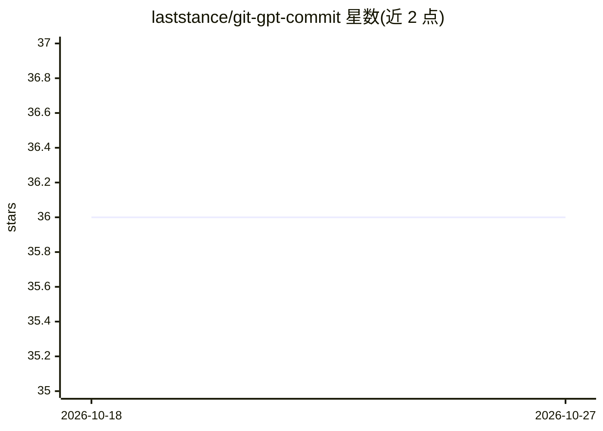

# laststance/git-gpt-commit

⭐ 36 · JavaScript · MIT · 推送 2026-05-07 · [GitHub](https://github.com/laststance/git-gpt-commit) · [官网](https://www.npmjs.com/package/@laststance/git-gpt-commit) · 个人维护

**用 OpenAI 模型生成 Git 提交信息的 CLI 扩展**

以 npm 全局包形式安装的 Git 扩展，提供 git gpt 系列子命令：读取已暂存的改动，调用 OpenAI API 生成提交信息并完成提交。支持选择模型（gpt-4o、gpt-3.5-turbo-instruct、gpt-4-turbo、gpt-4）、11 种提交信息语言、conventional commit 前缀开关；API key 存储于用户配置文件 ~/.git-gpt-commit-config.json。基于原作者 nooqta/git-commit-gpt 修复并扩展而来，MIT 许可。

## 筛选速览

| 维度 | 判定 | 备注 |
|---|---|---|
| AI 角色 | `ai-native` | 本体是模型或模型工具 |
| 许可风险 | `permissive` | MIT |
| 部署形态 | `library` | 以包/库形式分发 |
| 模型依赖 | — | README 未给出锁定关系 |
| 硬件要求 | — | 无带数字的原话,不猜 |
| 安装摩擦 | `low` | 无编译、无系统依赖或容器化 |
| 成熟度 | — | 结构信号不足 |

## 能力要点

- 基于暂存改动调用 OpenAI API 生成提交信息
- 可选 gpt-4o/gpt-4 等 4 种模型
- 提交信息支持 11 种语言
- conventional commit 前缀开关与配置管理命令

## 适用场景

- 不想手写提交信息时让 AI 根据 diff 自动生成
- 团队需要统一语言的提交信息
- 遵循 conventional commit 规范的项目自动化提交

## 场景标签

`AI 写作` · 领域:内容生成

## 证据(README 行号)

> L3:  <code>An AI-powered Git extension</code> that generates commit messages using OpenAI's models,
> L35: git gpt commit // generate commit message with AI

## 星数曲线

2026-10-18 36 → 2026-10-27 36（+0）

---
*卡片 v1 · prompt 1.4 · 生成 2026-10-25 · 置信度 high · 依据 README sha `e5daaf8c00f1` · [字段定义](../../DATASET.md)*
