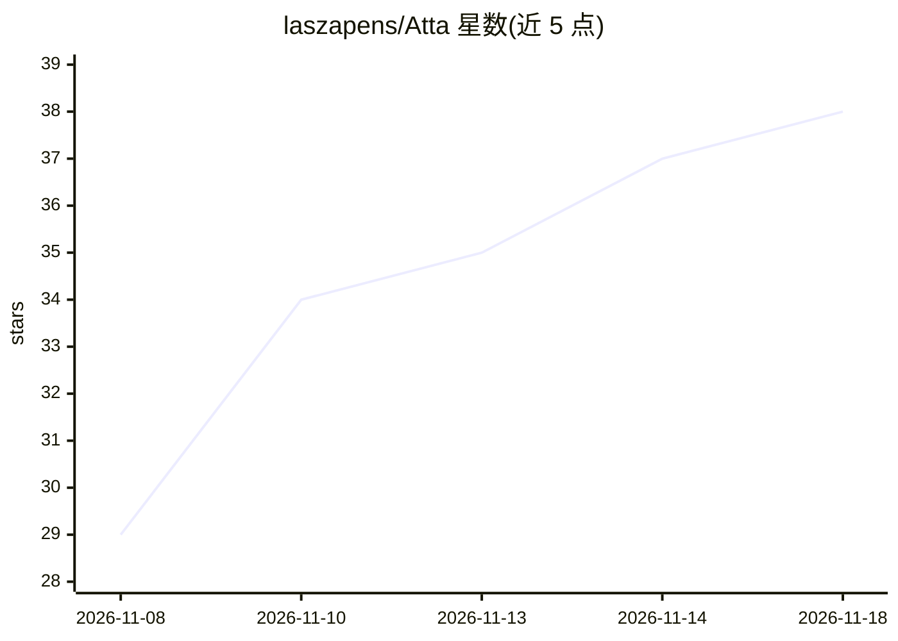

# laszapens/Atta

⭐ 38 · Python · MIT · 推送 2026-11-17 · [GitHub](https://github.com/laszapens/Atta) · 个人维护 · 中文 README

**面向 LLM agent 的参数化 CAD 内核：JSON 规格生成可验证几何**

供 LLM agent 驱动的参数化 CAD 内核：以 JSON spec 描述零件，用纯 Python(numpy) 构建几何，先测量后渲染——describe 返回包围盒、体积、壁厚、拓扑与 ASCII 截面等数值；verify 给出 pass/degraded/fail 三态判定，deliver 仅导出通过验证的模型（GLB/OBJ/STL/STEP）。每个 CLI 动词同时以 atta_* 形式暴露为 agent 工具，通过 MCP、DSH 插件、ZCode 插件或 HTTP 桥接入宿主。Blender 仅作为渲染与网格导出的可选后端，无 Blender 时几何、测量与验证仍可运行。当前版本 1.2.2beta。

## 筛选速览

| 维度 | 判定 | 备注 |
|---|---|---|
| AI 角色 | `ai-ecosystem` | LLM/agent 周边工具 |
| 许可风险 | `permissive` | MIT |
| 部署形态 | `library` | 以包/库形式分发 |
| 模型依赖 | — | README 未给出锁定关系 |
| 硬件要求 | — | 无带数字的原话,不猜 |
| 安装摩擦 | `low` | 无编译、无系统依赖或容器化 |
| 成熟度 | `idea` | |

## 能力要点

- JSON spec → 几何构建 → 测量 → 三态验证(pass/degraded/fail)的可审计流程
- 12 个 agent 工具（atta_* 前缀），支持 MCP/DSH/ZCode/HTTP 桥多种接入方式
- 测量优先：describe 约 0.3 秒返回 bbox、体积、壁厚、拓扑与 ASCII 截面，无需渲染即可检查
- 47 个特征操作含精确 CAD 圆角/倒角、NURBS、装配(SE(3)求解)与生物形态算子

## 适用场景

- 让编程或对话式 agent 按规格生成并验证 3D 零件几何
- 3D 打印前确认零件为封闭实体并导出 STL/STEP
- 通过参数采样或目标值求解探索设计空间

## 场景标签

`代码生成` · 领域:编码与开发

## 证据(README 行号)

> L7: Atta is a parametric CAD kernel meant to be driven by an LLM agent. You write a
> L90: Each CLI verb is also exposed as an agent tool with an `atta_` prefix.

## 星数曲线

2026-11-08 29 → 2026-11-18 38（+9）

---
*卡片 v1 · prompt 1.4 · 生成 2026-11-18 · 置信度 high · 依据 README sha `7326780f4732` · [字段定义](../../DATASET.md)*
