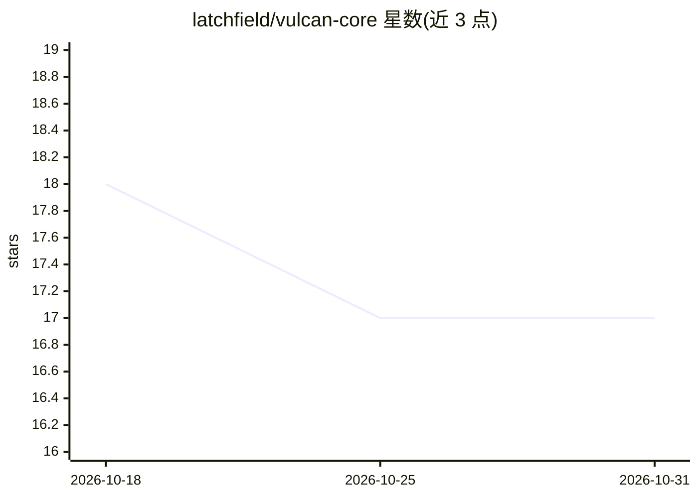

# latchfield/vulcan-core

⭐ 17 · Python · Apache-2.0 · 推送 2026-09-29 · [GitHub](https://github.com/latchfield/vulcan-core) · [官网](https://latchfield.com/vulcan/) · 组织维护

**结合 LLM 与声明式规则的 Python 规则引擎库，用于可解释推理**

面向开发者的 Python 库，提供 AI 混合规则引擎：用声明式规则表达确定性业务逻辑，在条件与数据检索处嵌入自然语言（由 LLM 与向量数据库处理），从而将计算逻辑与 LLM 预测分离，输出可解释、可复现的决策。提供规则创建、管理与执行的 API，文档含核心概念、教程与 API 参考。安装支持 uv/poetry/pip。

## 筛选速览

| 维度 | 判定 | 备注 |
|---|---|---|
| AI 角色 | `ai-ecosystem` | LLM/agent 周边工具 |
| 许可风险 | `permissive` | Apache-2.0 |
| 部署形态 | `library` | 以包/库形式分发 |
| 模型依赖 | — | README 未给出锁定关系 |
| 硬件要求 | — | 无带数字的原话,不猜 |
| 安装摩擦 | `low` | 无编译、无系统依赖或容器化 |
| 成熟度 | — | 结构信号不足 |

## 能力要点

- 声明式规则将确定性逻辑与 LLM 预测显式分离
- 条件与数据检索可用自然语言表达（microprompting）
- 决策过程提供完整可解释性
- 支持与 LLM 和向量数据库集成

## 适用场景

- 将长提示词改写为可复现、可解释的业务规则
- 在需要一致性与可审计决策的系统中结合 LLM 使用
- 为已有工具链引入规则化的 AI 决策层

## 场景标签

`Agent 框架` · 领域:Agent 开发

## 证据(README 行号)

> L6: Vulcan is an AI-hybrid rules engine designed for advanced automated reasoning. It combines the power of rule-based d
> L21: Vulcan strives to improve AI reliability and explainability by explicitly separating computational logic from LLM p

## 星数曲线

2026-10-18 18 → 2026-10-31 17（-1）

---
*卡片 v1 · prompt 1.4 · 生成 2026-10-29 · 置信度 high · 依据 README sha `d7c6c63026e1` · [字段定义](../../DATASET.md)*
