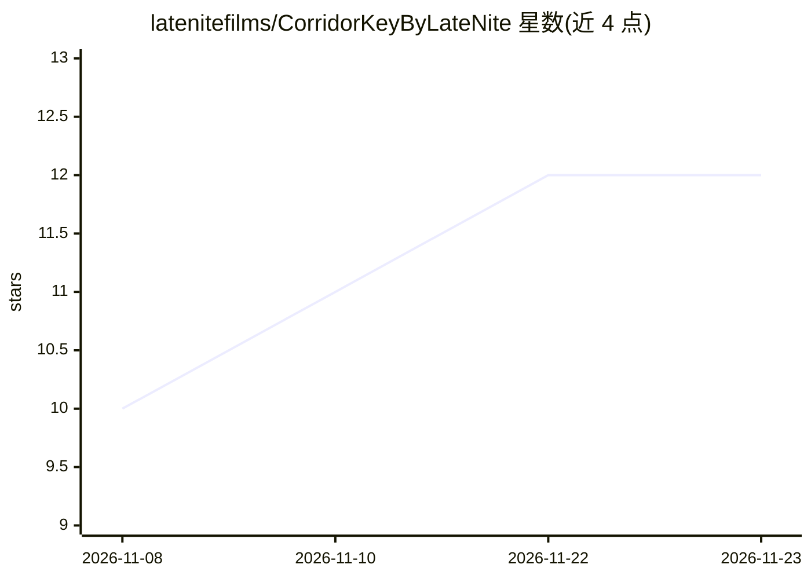

# latenitefilms/CorridorKeyByLateNite

⭐ 12 · Swift · NOASSERTION · 推送 2026-11-09 · [GitHub](https://github.com/latenitefilms/CorridorKeyByLateNite) · [官网](https://corridorkeybylatenite.fcp.cafe) · 组织维护

**把 CorridorKey v2 绿幕抠像模型带入 Final Cut Pro 的 Mac 工具**

将 Corridor Digital 的 CorridorKey v2 模型及其三个基础模型（C-RADIOv4-SO400M、MoGe-2 ViT-B、RVM-small）转换为 Apple MLX 格式，并用 Swift/SwiftUI 重新实现推理引擎，面向 Mac 与 Apple Silicon。以 Final Cut Pro 效果插件和独立编辑器两种形式提供，输入输出针对 ProRes 优化。仓库代码为 MIT 许可，分发时适用 CorridorKey License，模型另受 Corridor Key Licence 2.0 约束。

## 筛选速览

| 维度 | 判定 | 备注 |
|---|---|---|
| AI 角色 | `ai-native` | 本体是模型或模型工具 |
| 许可风险 | `none` | NOASSERTION |
| 部署形态 | `None` |  |
| 模型依赖 | — | README 未给出锁定关系 |
| 硬件要求 | — | 无带数字的原话,不猜 |
| 安装摩擦 | `low` | 无编译、无系统依赖或容器化 |
| 成熟度 | — | 结构信号不足 |

## 能力要点

- CorridorKey v2 模型转换到 Apple MLX，面向 Mac/Apple Silicon
- 提供 Final Cut Pro 效果插件与独立编辑器两种形态
- 输入输出针对 ProRes 优化
- 基于三个基础模型的统一抠像模型

## 适用场景

- 在 Final Cut Pro 中进行绿幕抠像
- 在 Mac 上独立运行抠像编辑器处理 ProRes 素材
- 后期制作/VFX 流程中替换绿幕背景

## 场景标签

`推理引擎` `图像视频处理` · 领域:感知与多模态

## 证据(README 行号)

> L3: **CorridorKey by LateNite** brings Corridor Digital's CorridorKey v2 to Final Cut Pro. 🥳
> L5: This is **NOT** a fork. We've converted the unified CorridorKey v2 model and its three foundation models to MLX and 
> L9: **CorridorKey by LateNite** brings an Effect directly into **Final Cut Pro**, as well as a **Standalone Editor** - o

## 星数曲线

2026-11-08 10 → 2026-11-23 12（+2）

---
*卡片 v1 · prompt 1.4 · 生成 2026-11-18 · 置信度 high · 依据 README sha `766b5daf1c8b` · [字段定义](../../DATASET.md)*
