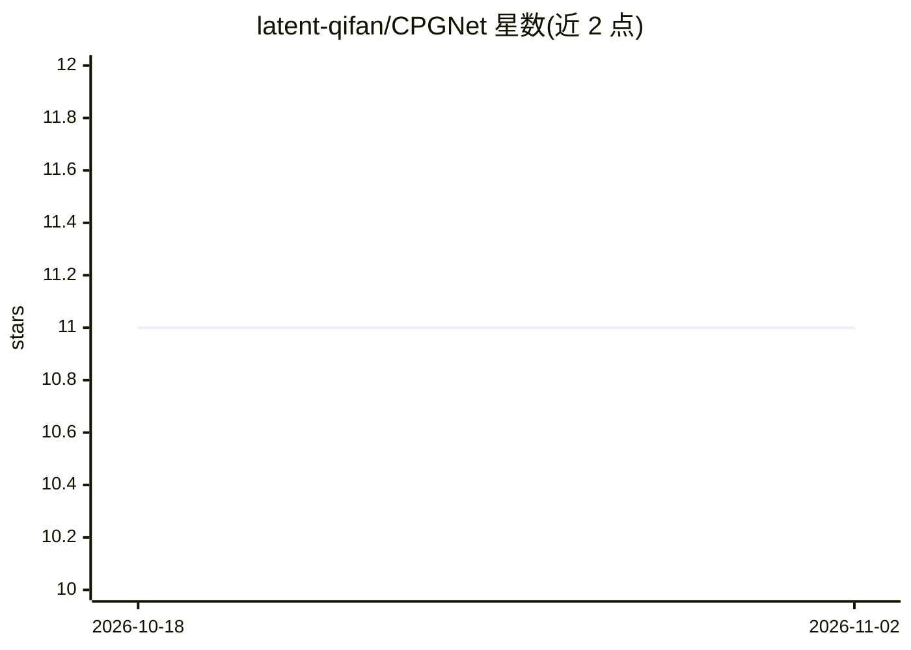

# latent-qifan/CPGNet

⭐ 11 · Python · 推送 2026-06-01 · [GitHub](https://github.com/latent-qifan/CPGNet) · [官网](https://arxiv.org/abs/2603.30008) · 个人维护 · 中文 README

**RGB-偏振条件引导的伪装目标检测框架**

CPGNet 是论文 'Conditional Polarization Guidance for Camouflaged Object Detection' 的官方实现，为非对称 RGB-偏振伪装目标检测框架：将偏振作为条件结构引导而非并行模态融合，包含 PIM（AoLP/DoLP 整合）、PGE（注入多尺度 RGB 特征）、EFM（DoLP 边缘引导频率细化）和 IFD（反馈迭代解码）四个组件。基于 PyTorch，提供 conda 环境搭建、PCOD 数据集结构说明、PVTv2-B2 预训练权重下载、训练/测试/评估脚本；训练权重经百度网盘分发。仓库不含数据集与预测图。

## 筛选速览

| 维度 | 判定 | 备注 |
|---|---|---|
| AI 角色 | `ai-native` | 本体是模型或模型工具 |
| 许可风险 | `none` | — |
| 部署形态 | `library` | 以包/库形式分发 |
| 模型依赖 | — | README 未给出锁定关系 |
| 硬件要求 | — | 无带数字的原话,不猜 |
| 安装摩擦 | `low` | 无编译、无系统依赖或容器化 |
| 成熟度 | — | 结构信号不足 |

## 能力要点

- 偏振作为条件结构引导的 RGB 表示学习
- PIM/PGE/EFM/IFM 四模块架构
- 提供训练、测试与评估完整脚本及默认复现配置

## 适用场景

- 在 PCOD 数据集上训练伪装目标检测模型
- 复现论文实验结果并评估检测指标
- RGB-偏振多模态检测方法研究参考

## 场景标签

`目标检测` `多模态` · 领域:感知与多模态

## 证据(README 行号)

> L3: Official anonymous implementation of **Conditional Polarization Guidance for Camouflaged Object Detection**.
> L7: CPGNet is an asymmetric RGB-polarization framework for camouflaged object detection. Instead of treating polarizatio

## 星数曲线

2026-10-18 11 → 2026-11-02 11（+0）

---
*卡片 v1 · prompt 1.4 · 生成 2026-11-02 · 置信度 mid · 依据 README sha `ad675294ee51` · [字段定义](../../DATASET.md)*
