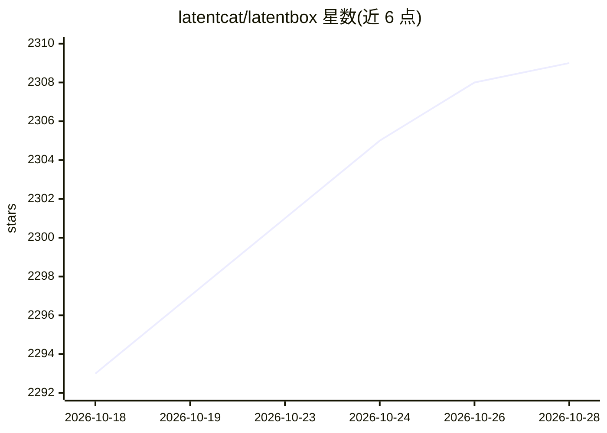

# latentcat/latentbox

⭐ 2,309 · TypeScript · NOASSERTION · 推送 2026-09-28 · [GitHub](https://github.com/latentcat/latentbox) · [官网](https://latentbox.com) · 组织维护 · 中文 README

**AI、创意与艺术领域的精选资源聚合清单站**

由 Latent Cat 组织维护的 AI/创意/艺术领域 awesome-list 聚合项目，以网站形式（latentbox.com）呈现并在 GitHub 开源。内容为人工策展的站点与产品清单，覆盖多个创意领域，接受社区通过各平台或 GitHub pull request 共建并署名贡献者。README 标注 WIP，处于持续建设中，未给出具体条目数量或安装运行方式。

## 筛选速览

| 维度 | 判定 | 备注 |
|---|---|---|
| AI 角色 | `ai-knowledge` | 知识聚合/清单类 |
| 许可风险 | `none` | NOASSERTION |
| 部署形态 | `None` |  |
| 模型依赖 | — | README 未给出锁定关系 |
| 硬件要求 | — | 无带数字的原话,不猜 |
| 安装摩擦 | `low` | 无编译、无系统依赖或容器化 |
| 成熟度 | `idea` | |

## 能力要点

- 人工策展的 AI/创意/艺术领域站点合集
- 整个网站在 GitHub 开源，支持 PR 共建与贡献者署名
- 以中英双语维护，配套 X/Discord/小红书/微信群渠道

## 适用场景

- 发现 AI 创意与艺术领域的工具和网站
- 按创意领域浏览跨界资源
- 通过提交 PR 向合集推荐内容

## 场景标签

`精选清单` · 领域:学习与行业

## 证据(README 行号)

> L3:  A collection of awesome-lists for AI, creativity and art. AI、创意和艺术领域的精选合集。
> L14: Latent Box is a reinvented resource site, maintained by Latent Cat. Why are we doing this? We have a few pursuits:

## 星数曲线

2026-10-18 2,293 → 2026-10-28 2,309（+16）

---
*卡片 v1 · prompt 1.4 · 生成 2026-10-21 · 置信度 high · 依据 README sha `6b3d9b79b28d` · [字段定义](../../DATASET.md)*
