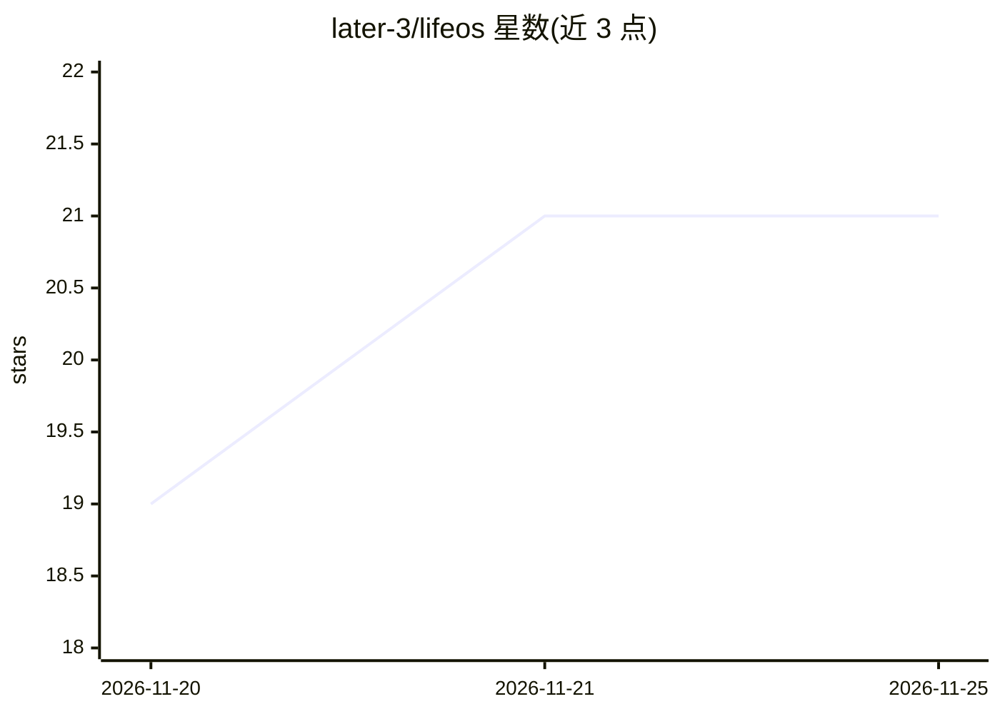

# later-3/lifeos

⭐ 21 · TypeScript · MIT · 推送 2026-11-23 · [GitHub](https://github.com/later-3/lifeos) · 个人维护 · 中文 README

**个人多 Agent 协作工作台：任务化协作与本地留存**

Life OS 是用户与一组 AI Agent 的长期协作系统，由两部分组成：交互 harness 协议（双方共同遵守的规则与资产，使协作方式可积累）和 Agent 工作台（任务、评审、批注、记忆的应用层）。任务为工作单位，Agent 在独立 git worktree 中工作，合并由用户完成；提供 23 个 Agent 工具、四层记忆结构、代理间消息传递。所有数据保存在本地 `~/.lifeos`，无账号无云端。运行需 Node.js ≥22.19.0 与 pnpm，模型端点为任意 OpenAI 兼容地址。

## 筛选速览

| 维度 | 判定 | 备注 |
|---|---|---|
| AI 角色 | `ai-ecosystem` | LLM/agent 周边工具 |
| 许可风险 | `permissive` | MIT |
| 部署形态 | `library` | 以包/库形式分发 |
| 模型依赖 | — | README 未给出锁定关系 |
| 硬件要求 | — | 无带数字的原话,不猜 |
| 安装摩擦 | `low` | 无编译、无系统依赖或容器化 |
| 成熟度 | — | 结构信号不足 |

## 能力要点

- 交互 harness 协议 + Agent 工作台的双层结构
- Agent 在 git worktree 中工作，用户负责合并
- 23 个 Agent 工具与四层记忆（agent×项目/项目共享/agent/用户）
- 本地优先：数据存于 ~/.lifeos，无账号无云端

## 适用场景

- 在本地用多个 Agent 分工处理开发与日常任务
- 对 Agent 产出的代码与文档差异做逐行评审与批注
- 把项目规范、案例与知识沉淀为可积累的项目资产

## 场景标签

`多智能体` · 领域:Agent 开发

## 证据(README 行号)

> L19: Life OS is a long-running collaboration system between you and a set of AI agents. It is built from two parts: an *
> L79: - **23 agent tools** — `lifeos_task_create`, `lifeos_task_enter`, `lifeos_ask`, `lifeos_send`, `lifeos_review_comme
> L172: |A model endpoint|any OpenAI-compatible base URL and key|

## 星数曲线

2026-11-20 19 → 2026-11-25 21（+2）

---
*卡片 v1 · prompt 1.4 · 生成 2026-11-20 · 置信度 high · 依据 README sha `a2961ca3148d` · [字段定义](../../DATASET.md)*
