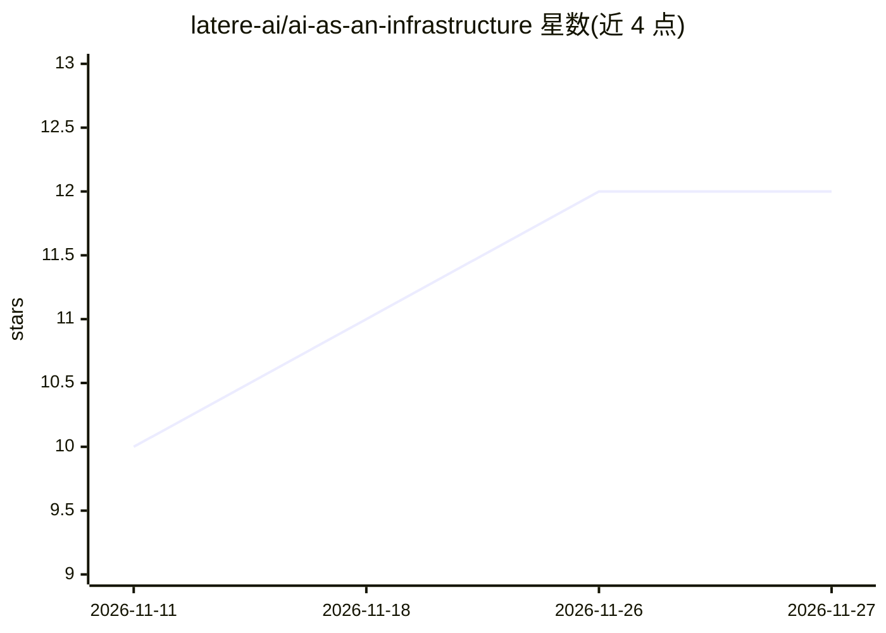

# latere-ai/ai-as-an-infrastructure

⭐ 12 · TypeScript · NOASSERTION · 推送 2026-11-16 · [GitHub](https://github.com/latere-ai/ai-as-an-infrastructure) · [官网](https://aaai.latere.ai) · 个人维护 · 中文 README

**面向系统工程师的 AI 基础设施交互式开放书**

一本以网页形式发布、将 AI 视为基础设施讲解的交互式书籍，覆盖 13 个部分、93 章，从算力、模型训练、推理服务、Agent 编排到评测、安全治理与经济学。特色是可运行的交互单元格与交互式图表（roofline、流水线并行、投机采样、树搜索）。目标读者是懂系统与分布式计算但不熟悉机器学习的软件工程师；每章按问题、设计、演进、权衡、实现的体例展开，并注明审阅日期。书籍仅限网页阅读，不支持静态 PDF/EPUB。

## 筛选速览

| 维度 | 判定 | 备注 |
|---|---|---|
| AI 角色 | `ai-knowledge` | 知识聚合/清单类 |
| 许可风险 | `none` | NOASSERTION |
| 部署形态 | `None` |  |
| 模型依赖 | — | README 未给出锁定关系 |
| 硬件要求 | — | 无带数字的原话,不猜 |
| 安装摩擦 | `medium` | 含编译或系统依赖之一 |
| 成熟度 | — | 结构信号不足 |

## 能力要点

- 13 个部分、93 章，覆盖从算力到治理 Agent 的完整生命周期
- 交互式图表与可运行单元格（roofline、GPipe/1F1B、投机采样等）
- 英文与中文双版本内容一致，在线阅读
- 每章附审阅日期、变更日志与领域动态页

## 适用场景

- 系统背景的工程师系统学习机器学习与 AI 基础设施概念
- 查阅推理服务、KV cache、量化等 serving 主题的设计权衡
- 跟踪 AI 领域最新进展与对应章节的链接

## 场景标签

`教程课程` · 领域:学习与行业

## 证据(README 行号)

> L18: A book that treats AI as an infrastructure and explains it design-first.
> L31: The book is web-only: its runnable cells, interactive figures, and diagrams do
> L48: ## Outline

## 星数曲线

2026-11-11 10 → 2026-11-27 12（+2）

---
*卡片 v1 · prompt 1.4 · 生成 2026-11-18 · 置信度 high · 依据 README sha `84340bab2193` · [字段定义](../../DATASET.md)*
