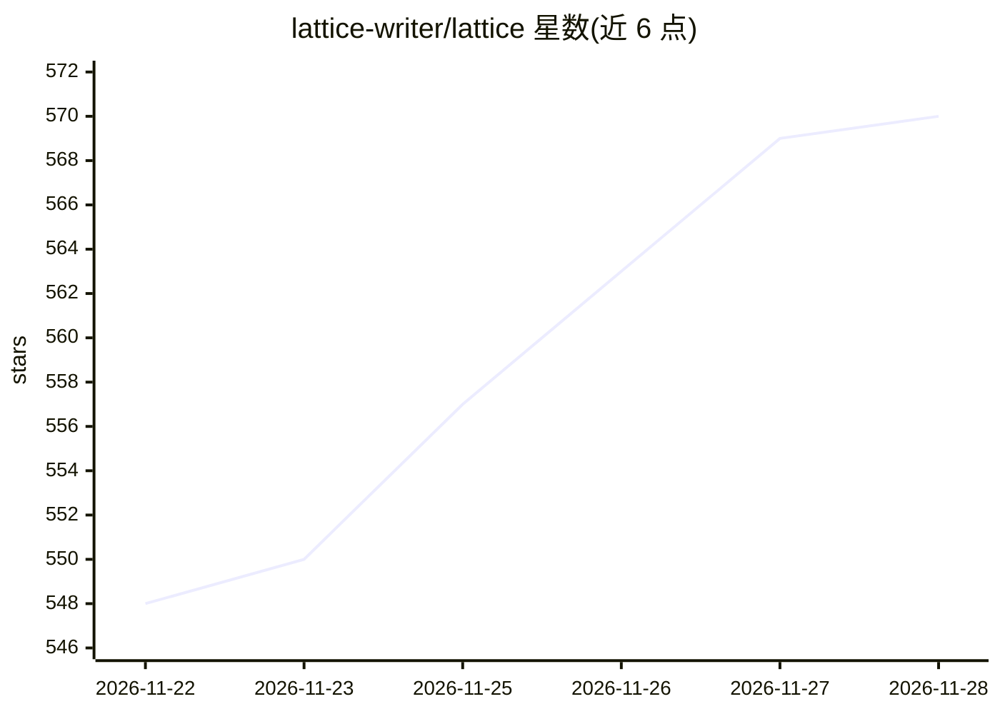

# lattice-writer/lattice

⭐ 570 · Rust · Apache-2.0 · 推送 2026-11-27 · [GitHub](https://github.com/lattice-writer/lattice) · [官网](https://lattice-writer.github.io/lattice/) · 组织维护 · 中文 README

**面向 macOS 学术写作者的本地优先 LaTeX 工作区，内置 AI agent**

Lattice 是一个本地优先的 LaTeX 写作应用：项目以普通磁盘文件夹保存，支持源码/PDF 并排编辑、SyncTeX 双向跳转、内置模板与 arXiv 导出、注释轮次修订、文献库（arXiv/DOI/Zotero 导入、Crossref 参考文献核查）以及双向 Overleaf 同步。AI 部分通过运行本机已有的 agent CLI（Claude Code、Codex 等）或自定义 OpenAI/Anthropic 兼容 API 端点工作，agent 的修改以可撤销的 diff 呈现；应用本身不自带模型或订阅。

## 筛选速览

| 维度 | 判定 | 备注 |
|---|---|---|
| AI 角色 | `ai-enhanced` | 去掉 AI 部分产品仍成立 |
| 许可风险 | `permissive` | Apache-2.0 |
| 部署形态 | `desktop` | 安装包/桌面程序 |
| 模型依赖 | — | README 未给出锁定关系 |
| 硬件要求 | — | 无带数字的原话,不猜 |
| 安装摩擦 | `low` | 无编译、无系统依赖或容器化 |
| 成熟度 | — | 结构信号不足 |

## 能力要点

- 本地文件夹为源，Overleaf 双向同步并支持实时协作评论与修订
- Agent 面板可运行 Claude Code/Codex 等本机 agent CLI 或自定义兼容 API 端点
- 文献库支持 arXiv/DOI/Zotero 导入与 Crossref 参考文献核查
- 版本时间线、track changes 与 latexdiff 对比导出

## 适用场景

- 在 Mac 上写并编译 LaTeX 论文并导出 arXiv 投稿包
- 让 AI agent 逐条处理审稿注释并逐项接受/拒绝修改
- 与停留在 Overleaf 的合作者双向同步稿件
- 管理个人文献库并核查参考文献

## 场景标签

`科研工具` · 领域:学习与行业

## 证据(README 行号)

> L7: A local-first LaTeX workspace for macOS, with your papers, your co-authors and an AI agent in the same window
> L42: The Agent panel runs Claude Code or Codex, or another agent CLI on your Mac such as Cursor, Antigravity (`agy`), Op
> L44: Lattice comes with no model and no AI subscription of its own.

## 星数曲线

2026-11-22 548 → 2026-11-28 570（+22）

---
*卡片 v1 · prompt 1.4 · 生成 2026-11-28 · 置信度 high · 依据 README sha `b40c69a4d695` · [字段定义](../../DATASET.md)*
