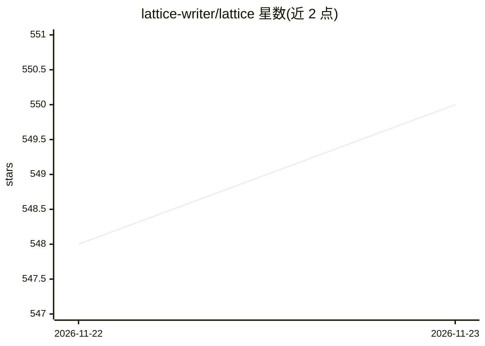

# lattice-writer/lattice

⭐ 550 · Rust · Apache-2.0 · 推送 2026-11-22 · [GitHub](https://github.com/lattice-writer/lattice) · [官网](https://lattice-writer.github.io/lattice/) · 组织维护 · 中文 README

**macOS 本地优先 LaTeX 写作应用，集成 agent 编辑论文**

基于 Tauri 的 macOS LaTeX 工作区，将源码、实时 PDF、文献库、批注与 Overleaf 同步放在同一窗口；项目保持为磁盘上的普通文件夹，可离线使用并纳入 Git。AI 部分：Agent 面板运行 Claude Code/Codex 或其他 agent CLI，也可接入 OpenAI/Anthropic 兼容 API，agent 读取项目、修构建错误、按批注逐条提议修改，所有改动以 diff 呈现可撤销；应用本身不带模型、不要求 AI 订阅。提供 dmg/Homebrew 安装及实验性 Linux/Windows 构建。

## 筛选速览

| 维度 | 判定 | 备注 |
|---|---|---|
| AI 角色 | `ai-enhanced` | 去掉 AI 部分产品仍成立 |
| 许可风险 | `permissive` | Apache-2.0 |
| 部署形态 | `desktop` | 安装包/桌面程序 |
| 模型依赖 | — | README 未给出锁定关系 |
| 硬件要求 | — | 无带数字的原话,不猜 |
| 安装摩擦 | `low` | 无编译、无系统依赖或容器化 |
| 成熟度 | — | 结构信号不足 |

## 能力要点

- Agent 面板运行 Claude Code/Codex/Cursor 等 agent CLI，改动以 diff 可审阅
- 双向 Overleaf 同步，含实时 presence、评论与 tracked changes
- 文献库支持 arXiv/DOI/Zotero 导入，Check references 对照 Crossref 审校
- 从模板起步并一键 Export for arXiv ZIP

## 适用场景

- 在本地 Mac 上写作并编译 LaTeX 论文
- 与使用 Overleaf 的合作者双向同步修改
- 让 agent 按批注逐条修改论文并逐项审阅
- 整理参考文献并对照 Crossref 核查引用

## 场景标签

`编码 Agent` `科研工具` · 领域:编码与开发

## 证据(README 行号)

> L7: A local-first LaTeX workspace for macOS, with your papers, your co-authors and an AI agent in the same window
> L42: The Agent panel runs Claude Code or Codex, or another agent CLI on your Mac such as Cursor, OpenCode or Droid, sign
> L44: Lattice comes with no model and no AI subscription of its own.

## 星数曲线

2026-11-22 548 → 2026-11-23 550（+2）

---
*卡片 v1 · prompt 1.4 · 生成 2026-11-22 · 置信度 high · 依据 README sha `9568a09bab7f` · [字段定义](../../DATASET.md)*
