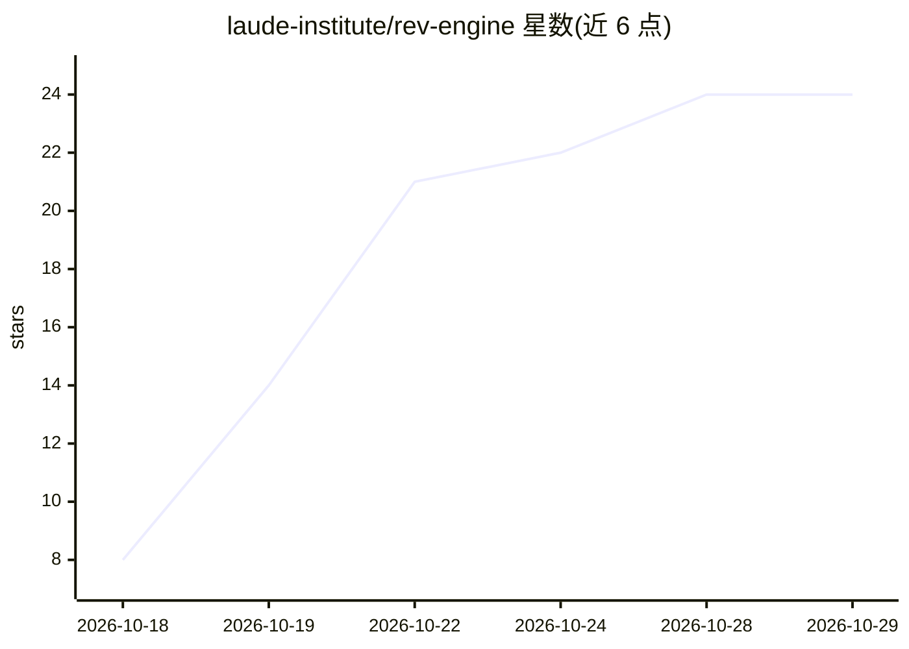

# laude-institute/rev-engine

⭐ 24 · TypeScript · Apache-2.0 · 推送 2026-10-27 · [GitHub](https://github.com/laude-institute/rev-engine) · 组织维护

**以 GitHub Action 运行的 agentic 代码审查工具**

RevEngine 是以 GitHub Action 形式部署在自有仓库中的代码审查工具：在 PR 下评论 /review 触发，审查流程分 Review、Verify、Rank 三步——强模型用只读工具理解变更，第二轮核验每个发现并剔除不成立项，最后按严重度与置信度排序合并去重，输出行内评论与含合并建议的摘要。也支持面向管理 PR 的 agent 的快速廉价模型群审查模式。模型只读不执行代码，PR 文本按不可信输入处理，项目规则从基础分支读取，仅写权限者可触发。每次审查消耗模型 token（Claude Opus 5.5 下约 3 分钟、约 $1）。作者声明为早期工作，变更频繁。

## 筛选速览

| 维度 | 判定 | 备注 |
|---|---|---|
| AI 角色 | `ai-native` | 本体是模型或模型工具 |
| 许可风险 | `permissive` | Apache-2.0 |
| 部署形态 | `None` |  |
| 模型依赖 | locked-api |  |
| 硬件要求 | — | 无带数字的原话,不猜 |
| 安装摩擦 | `low` | 无编译、无系统依赖或容器化 |
| 成熟度 | `idea` | |

## 能力要点

- Review/Verify/Rank 三步流程：核验发现、剔除不成立项、按严重度排序
- 安全机制：模型只读不执行、PR 文本按不可信输入、规则从基础分支读取、仅写权限者可触发
- 支持面向 agent 的快速廉价模型群审查模式（/review agent）
- 作为 GitHub Action 在自有仓库运行

## 适用场景

- 在自己的仓库里通过 PR 评论触发 AI 代码审查
- 让管理 PR 的 agent 获得单条评论汇总的审查结果
- 在合并前获得带合并建议的审查摘要

## 场景标签

`代码审查` · 领域:编码与开发

## 证据(README 行号)

> L5: **RevEngine** is a code reviewer you can run as a GitHub Action in your own repo.
> L16: 3. The findings come back as one review, with comments on the changed lines and a short summary that opens with mer
> L26: 1. **Review.** A strong model reads the change with read-only tools. It is asked to understand the system before ju

## 星数曲线

2026-10-18 8 → 2026-10-29 24（+16）

---
*卡片 v1 · prompt 1.4 · 生成 2026-10-27 · 置信度 high · 依据 README sha `74d140a64d53` · [字段定义](../../DATASET.md)*
