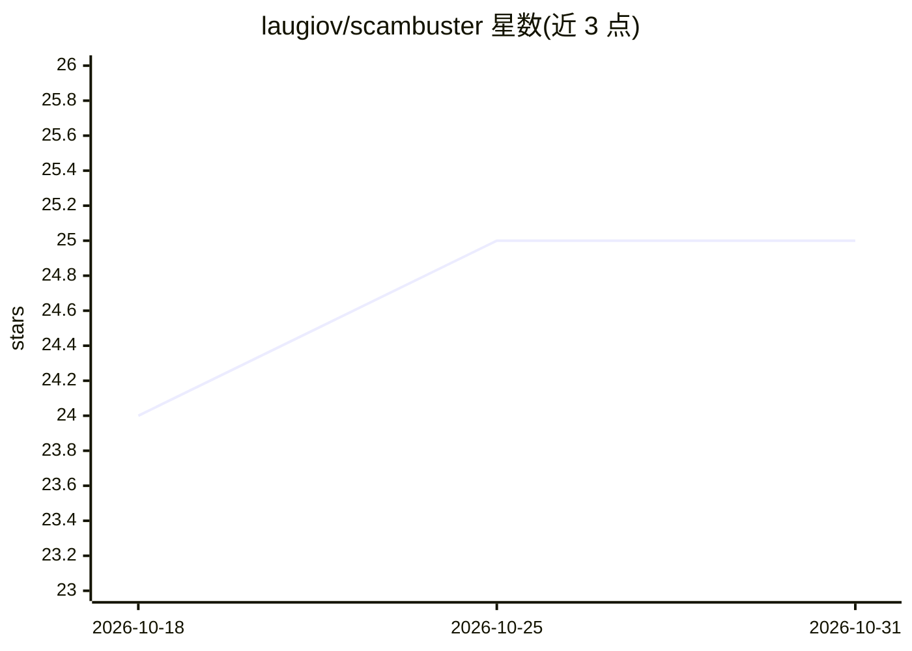

# laugiov/scambuster

⭐ 25 · PHP · MIT · 推送 2026-09-01 · [GitHub](https://github.com/laugiov/scambuster) · 个人维护

**入站诈骗邮件诱饵蜜罐：AI 多代理周旋并产出威胁情报 IOC**

面向安全研究与运营的防御性蜜罐平台：接收入站诈骗邮件后，由 8 个 LLM 代理（分类、IOC 提取、回复生成、安全校验、策略护栏等）按策略与诈骗者周旋，将往来内容转化为 STIX 2.1 包、TAXII 2.1 服务、MISP 事件 JSON 及 SIEM 导出。人格选择采用 epsilon-greedy/UCB1 自适应学习。限制：仅邮件入站、不阻断过滤、OpenCTI 外导出路径未经实测。通过 git clone 与 make quickstart 部署，Docker Compose 单机运行。

## 筛选速览

| 维度 | 判定 | 备注 |
|---|---|---|
| AI 角色 | `ai-native` | 本体是模型或模型工具 |
| 许可风险 | `permissive` | MIT |
| 部署形态 | `self-host` | docker 或自建部署 |
| 模型依赖 | — | README 未给出锁定关系 |
| 硬件要求 | — | 无带数字的原话,不猜 |
| 安装摩擦 | `low` | 无编译、无系统依赖或容器化 |
| 成熟度 | — | 结构信号不足 |

## 能力要点

- 8 个 LLM 代理流水线：分类 13 类诈骗、提取 36 类 IOC、双层提示注入检测
- 输出 STIX 2.1 / TAXII 2.1 / MISP / SIEM 标准格式，已对 OpenCTI 端到端验证
- epsilon-greedy + UCB1 自适应选择回复人格
- PolicyGuard 内容过滤、速率限制与多级 kill switch

## 适用场景

- 安全团队以蜜罐邮箱收集诈骗活动情报并导出 IOC 到 OpenCTI/MISP/SIEM
- 研究人员对诈骗者行为、战术与心理画像做观测分析
- 在策略护栏内对入站诈骗邮件做受控周旋

## 场景标签

`网络安全` `多智能体` · 领域:Agent 开发

## 证据(README 行号)

> L27: |**IocExtractor**|Extracts 36 IOC types with context|
> L29: |**Validator**|Safety and quality gate (PolicyGuard + LLM)|

## 星数曲线

2026-10-18 24 → 2026-10-31 25（+1）

---
*卡片 v1 · prompt 1.4 · 生成 2026-10-27 · 置信度 high · 依据 README sha `29e4c4cf0541` · [字段定义](../../DATASET.md)*
