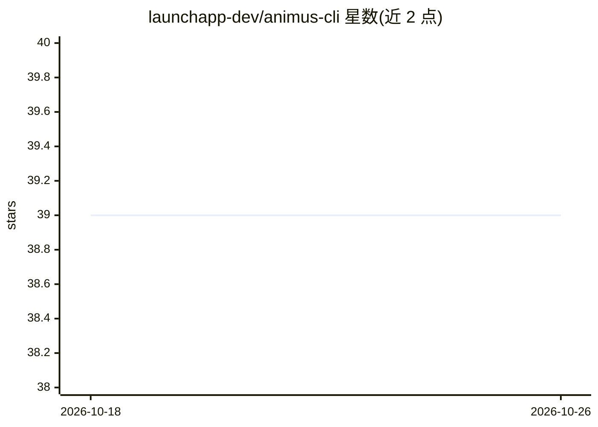

# launchapp-dev/animus-cli

⭐ 39 · Rust · NOASSERTION · 推送 2026-10-12 · [GitHub](https://github.com/launchapp-dev/animus-cli) · [官网](https://animus-docs.vercel.app/) · 组织维护

**Rust 编写的多 AI 编码代理编排器，用 YAML 工作流并行运行开发代理团队**

面向并行维护多个项目的创始人/独立开发者：以 YAML 定义代理团队（agents/phases/workflows），由 Rust 守护进程调度，在独立 git worktree 中并行运行 Claude Code、Codex、Gemini、OpenCode、Ollama 等编码代理，通过决策契约与质量门控产出评审后的 PR。核心架构为插件化：provider、subject 后端、工作流运行器、队列、web UI 均为独立插件，守护进程无插件时拒绝启动。支持 cron 调度、webhook 触发、MCP 集成与模型按复杂度路由。安装主要面向 macOS，Linux/Windows 需从源码或发布包构建。

## 筛选速览

| 维度 | 判定 | 备注 |
|---|---|---|
| AI 角色 | `ai-ecosystem` | LLM/agent 周边工具 |
| 许可风险 | `none` | NOASSERTION |
| 部署形态 | `library` | 以包/库形式分发 |
| 模型依赖 | locked-api |  |
| 硬件要求 | — | 无带数字的原话,不猜 |
| 安装摩擦 | `low` | 无编译、无系统依赖或容器化 |
| 成熟度 | — | 结构信号不足 |

## 能力要点

- YAML 定义 agents/phases/workflows，代理阶段返回类型化决策契约（advance/rework/skip/fail）
- 插件化守护进程：provider、subject、workflow_runner、queue 等均以独立插件安装
- 每个任务独立 git worktree，代理并行工作于不同分支
- cron 调度与 file_watcher/webhook/github_webhook 触发器

## 适用场景

- 我同时跑多个项目，想让 AI 代理团队并行完成开发任务并开 PR
- 按任务复杂度自动路由到不同模型以控制成本
- 通过 Linear/Jira/GitHub Issues 等跟踪器驱动代理工作流

## 场景标签

`多智能体` `编码 Agent` · 领域:Agent 开发

## 证据(README 行号)

> L102: Define your agent team in YAML. Animus runs them in parallel git worktrees,
> L106: Use Claude, Codex, Gemini, OpenCode, Ollama, or any coding agent you already use.
> L112: The core daemon is the orchestration runtime; providers, subject backends, triggers, transports, web UI, and log s

## 星数曲线

2026-10-18 39 → 2026-10-26 39（+0）

---
*卡片 v1 · prompt 1.4 · 生成 2026-10-25 · 置信度 mid · 依据 README sha `62743474319e` · [字段定义](../../DATASET.md)*
