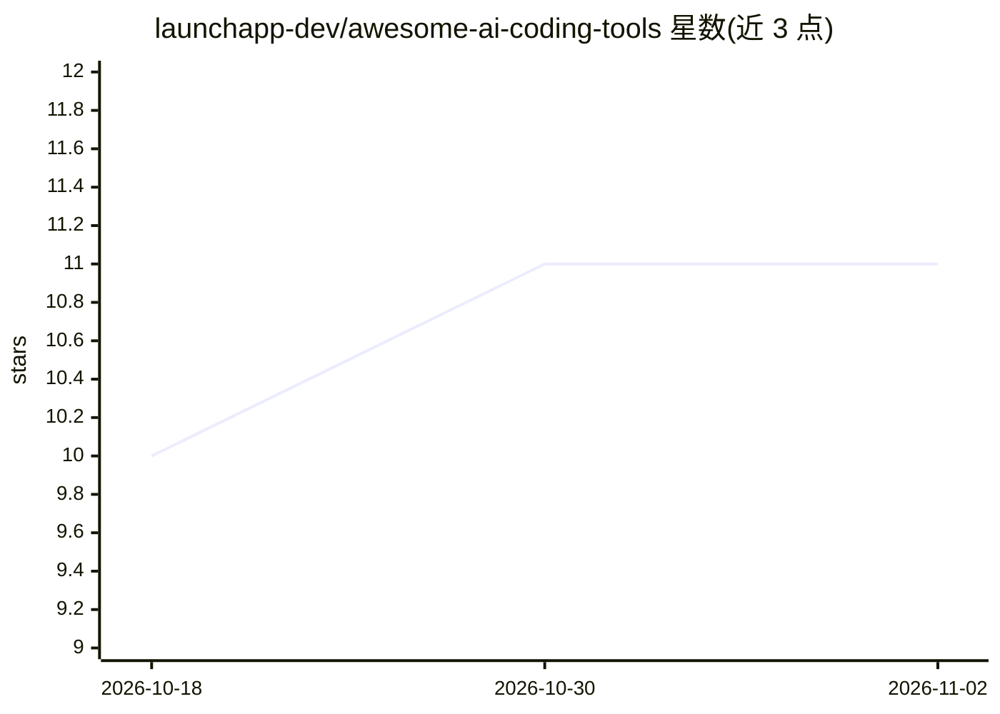

# launchapp-dev/awesome-ai-coding-tools

⭐ 11 · NOASSERTION · 推送 2026-11-01 · [GitHub](https://github.com/launchapp-dev/awesome-ai-coding-tools) · [官网](https://github.com/launchapp-dev/awesome-ai-coding-tools) · 组织维护

**AI 编程工具策展清单：编辑器、Agent、代码审查、测试等**

由 LaunchApp 维护的 AI 编程工具精选清单，按 AI 代码编辑器/IDE、编辑器内补全助手、自主编程 Agent、CLI 终端工具、多 Agent 编排、代码审查与 PR 自动化、测试 QA 等类别组织条目，覆盖 Cursor、Claude Code、Aider 等工具。每条目用开源/付费/免费层/可自托管/编辑精选等图例标注，面向在职开发者筛选可用工具，接受社区贡献。

## 筛选速览

| 维度 | 判定 | 备注 |
|---|---|---|
| AI 角色 | `ai-knowledge` | 知识聚合/清单类 |
| 许可风险 | `none` | NOASSERTION |
| 部署形态 | `None` |  |
| 模型依赖 | — | README 未给出锁定关系 |
| 硬件要求 | — | 无带数字的原话,不猜 |
| 安装摩擦 | `low` | 无编译、无系统依赖或容器化 |
| 成熟度 | — | 结构信号不足 |

## 能力要点

- 按编辑器、Agent、CLI、编排、代码审查、测试等类别组织
- 开源/付费/免费层/可自托管/编辑精选图例标注条目
- 收录条目覆盖从补全到自主 Agent 的工具类型
- 开放社区贡献（contributing.md）

## 适用场景

- 挑选 AI 代码编辑器或编辑器内补全工具
- 对比自主编程 Agent 与多 Agent 编排框架
- 为团队寻找可自托管的代码审查工具

## 场景标签

`精选清单` · 领域:学习与行业

## 证据(README 行号)

> L3: > A curated list of AI-powered tools for developers — editors, agents, code review, testing, CLI tools, MCP servers,
> L5: AI coding has gone from autocomplete to autonomous teams in two years. This list helps you cut through the noise: th

## 星数曲线

2026-10-18 10 → 2026-11-02 11（+1）

---
*卡片 v1 · prompt 1.4 · 生成 2026-11-02 · 置信度 high · 依据 README sha `f5562f8be769` · [字段定义](../../DATASET.md)*
