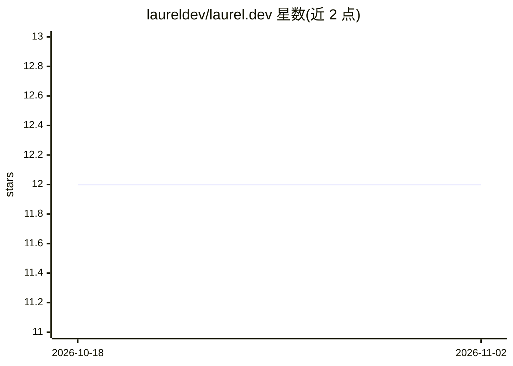

# laureldev/laurel.dev

⭐ 12 · Python · MIT · 推送 2026-07-09 · [GitHub](https://github.com/laureldev/laurel.dev) · [官网](https://www.laurel.dev) · 组织维护

**给 LLM agent 的自托管网页搜索/抓取 API（open core）**

自托管的 FastAPI 服务，仅两个端点：/search 调用 Google Custom Search API 并整形结果（自带 key），/fetch 下载网页、经 readability 提取正文并转为 Markdown，供 agent 引用。核心代码集中在 api/main.py，通过 Docker Compose 部署。定位为 laurel.dev 托管服务的开源核心，不含缓存、配额、计费与规模化运维部分，搜索受 Google 免费额度限制（100 次/天）。不提供客户端 SDK 或 MCP 封装，需自行接入 agent 框架。

## 筛选速览

| 维度 | 判定 | 备注 |
|---|---|---|
| AI 角色 | `ai-ecosystem` | LLM/agent 周边工具 |
| 许可风险 | `permissive` | MIT |
| 部署形态 | `self-host` | docker 或自建部署 |
| 模型依赖 | — | README 未给出锁定关系 |
| 硬件要求 | — | 无带数字的原话,不猜 |
| 安装摩擦 | `low` | 无编译、无系统依赖或容器化 |
| 成熟度 | — | 结构信号不足 |

## 能力要点

- /search 与 /fetch 两个端点，search→fetch 两步流程
- /fetch 经 readability 提取正文并转为 clean Markdown
- 单文件核心（api/main.py），Docker Compose 一键部署
- MIT 许可，声明为 laurel.dev 托管服务的开源核心

## 适用场景

- 为我的 agent 提供自托管的网页搜索与正文抓取工具
- 以 function-calling 或自建 MCP 封装接入现有 agent 框架
- 学习并自行改造一个面向 agent 的 web-context API 核心

## 场景标签

`网页抓取` · 领域:效率与自动化

## 证据(README 行号)

> L3: A tiny, self-hostable **web-context API for LLM agents**. Two endpoints:
> L104: The whole point is to hand these two tools to a model. Roughly:
> L106: 1. Expose `/search` and `/fetch` as tools (function-calling, or wrap them behind

## 星数曲线

2026-10-18 12 → 2026-11-02 12（+0）

---
*卡片 v1 · prompt 1.4 · 生成 2026-11-01 · 置信度 high · 依据 README sha `bdf1ba5a48b7` · [字段定义](../../DATASET.md)*
