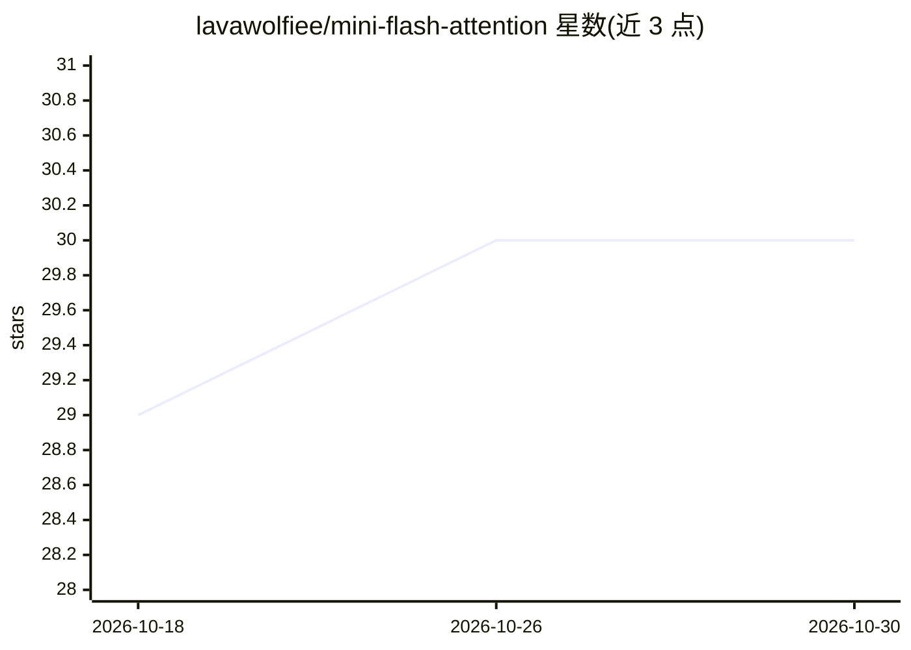

# lavawolfiee/mini-flash-attention

⭐ 30 · Cuda · 推送 2026-06-02 · [GitHub](https://github.com/lavawolfiee/mini-flash-attention) · 个人维护

**教学用 FlashAttention 前向 CUDA 内核实现（WMMA/CuTe）**

以可读性为目标的最小 FlashAttention 前向算子：提供 WMMA 与 CuTe/CUTLASS 两个 CUDA 内核（分别约 150/250 行），实现分块 Q@K^T、在线 softmax、Tensor Core MMA、寄存器驻留累加与 swizzled 共享内存，不分配 O(N²) 全局工作区。当前限定：仅前向、fp16、D=64、非因果、输入布局 [B·H,N,D]。RTX A4000 基准显示 CuTe 内核比朴素 PyTorch 快至 4.5x；作者声明这是教学项目，非 flash-attn 生产替代。

## 筛选速览

| 维度 | 判定 | 备注 |
|---|---|---|
| AI 角色 | `ai-ecosystem` | LLM/agent 周边工具 |
| 许可风险 | `none` | — |
| 部署形态 | `None` |  |
| 模型依赖 | — | README 未给出锁定关系 |
| 硬件要求 | — | 无带数字的原话,不猜 |
| 安装摩擦 | `medium` | 含编译或系统依赖之一 |
| 成熟度 | — | 结构信号不足 |

## 能力要点

- WMMA 与 CuTe/CUTLASS 两个可读内核实现
- 在线 softmax + Tensor Core，不物化 N×N 注意力矩阵
- RTX A4000 基准：CuTe 内核较朴素 PyTorch 至 4.5x 加速、峰值显存约 8 MB
- 限制：仅前向、fp16、D=64、非因果

## 适用场景

- 阅读与学习 FlashAttention 算法的 CUDA 实现
- 修改、profile 内核以理解各步骤对性能的影响
- 作为编写自定义注意力 kernel 的起点

## 场景标签

`教程课程` · 领域:学习与行业

## 证据(README 行号)

> L3: A small, readable FlashAttention-style forward pass implemented in CUDA C++.
> L41: This project implements the FlashAttention idea directly in CUDA:
> L108: This is an educational project, not a production replacement for `flash-attn`.

## 星数曲线

2026-10-18 29 → 2026-10-30 30（+1）

---
*卡片 v1 · prompt 1.4 · 生成 2026-10-26 · 置信度 high · 依据 README sha `f2a03d458ab8` · [字段定义](../../DATASET.md)*
