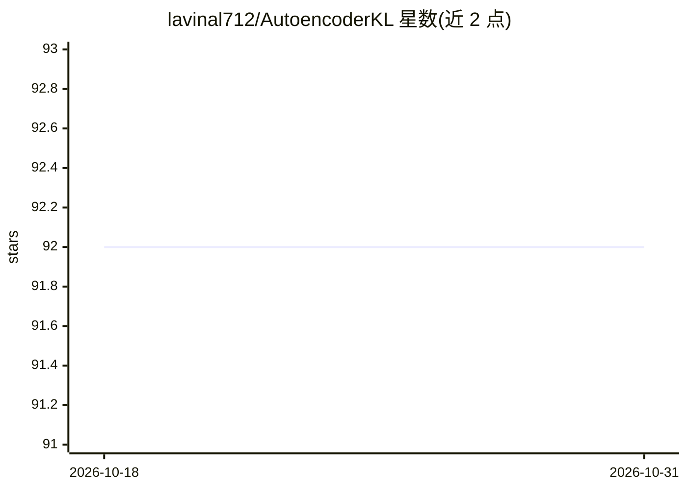

# lavinal712/AutoencoderKL

⭐ 92 · Python · MIT · 推送 2026-10-30 · [GitHub](https://github.com/lavinal712/AutoencoderKL) · 个人维护 · 中文 README

**训练/微调/评测 Stable Diffusion 与 FLUX VAE 的 PyTorch Lightning 工具包**

面向扩散模型研究者的 AutoencoderKL 训练工具包：基于 PyTorch Lightning 支持训练与微调 Stable Diffusion、SDXL、FLUX 的 VAE，以及带 VQ/RVQ/FSQ/LFQ 量化方式的 VQ-VAE 和 VQGAN。评测模块以 rFID、PSNR、SSIM、LPIPS 衡量重建质量，支持多 GPU/多节点训练与评测，可直接加载 HuggingFace 权重评估，并提供转换 diffusers 格式与计算 scaling_factor 的脚本。自带训练调参指南（学习率、判别器启用时机、感知损失）。以源码仓库形式提供，需自写数据加载器训练自有数据。

## 筛选速览

| 维度 | 判定 | 备注 |
|---|---|---|
| AI 角色 | `ai-ecosystem` | LLM/agent 周边工具 |
| 许可风险 | `permissive` | MIT |
| 部署形态 | `library` | 以包/库形式分发 |
| 模型依赖 | — | README 未给出锁定关系 |
| 硬件要求 | — | 无带数字的原话,不猜 |
| 安装摩擦 | `low` | 无编译、无系统依赖或容器化 |
| 成熟度 | — | 结构信号不足 |

## 能力要点

- 训练/微调 SD VAE 与 FLUX VAE，量化支持 VQ/RVQ/FSQ/LFQ
- rFID/PSNR/SSIM/LPIPS 重建质量评测，torchmetrics 在线指标
- 多 GPU 多节点训练与评测，可加载 HuggingFace 权重
- 提供转换 diffusers 格式与计算 scaling_factor/shift_factor 的脚本

## 适用场景

- 训练用于扩散模型的 VAE 潜空间压缩器
- 微调已有 VAE 并保持原潜空间
- 对比不同 VAE 在 ImageNet 上的重建质量

## 场景标签

`微调` `模型评测` · 领域:评测与运维

## 证据(README 行号)

> L9: There are many great training scripts for VAE on Github. However, some repositories are not maintained and some are 
> L11: - Support training and finetuning both Stable Diffusion VAE and FLUX VAE.
> L15: - Research-friendly codebase that is easy to modify and extend for custom architectures, losses, and training strat

## 星数曲线

2026-10-18 92 → 2026-10-31 92（+0）

---
*卡片 v1 · prompt 1.4 · 生成 2026-10-23 · 置信度 mid · 依据 README sha `eef35afea132` · [字段定义](../../DATASET.md)*
