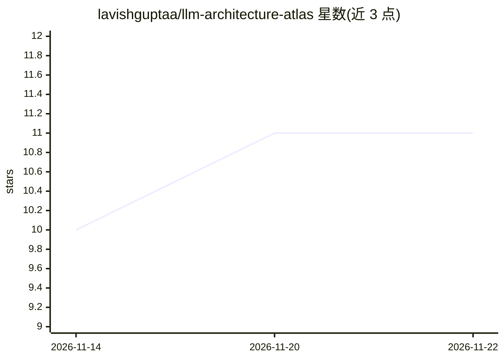

# lavishguptaa/llm-architecture-atlas

⭐ 11 · Python · MIT · 推送 2026-11-18 · [GitHub](https://github.com/lavishguptaa/llm-architecture-atlas) · 个人维护

**96 个 LLM 架构的从零 PyTorch 实现合集**

以纯 PyTorch 从零实现现代大语言模型架构的开源合集，每个模型独立一个文件夹、一个自包含 model.py，不依赖 transformers 的模型代码。每模型附 KV-cache 变体、官方 config.json 与 tokenizer 文件；另有独立注意力机制实现目录作学习路径。覆盖 RoPE 变体、GQA、MLA、稀疏 MoE 路由等架构特性。限制：演示用随机初始化权重，未用真实预训练权重验证，70B+ 大配置需数百 GB 内存。

## 筛选速览

| 维度 | 判定 | 备注 |
|---|---|---|
| AI 角色 | `ai-native` | 本体是模型或模型工具 |
| 许可风险 | `permissive` | MIT |
| 部署形态 | `library` | 以包/库形式分发 |
| 模型依赖 | — | README 未给出锁定关系 |
| 硬件要求 | — | 无带数字的原话,不猜 |
| 安装摩擦 | `low` | 无编译、无系统依赖或容器化 |
| 成熟度 | `idea` | |

## 能力要点

- 96 个模型各一个自包含 model.py，含可运行 main() 演示
- 每个模型配 KV-cache 变体文件，原实现保持不变
- attention-mechanisms/ 目录独立实现注意力构件
- 最小依赖 torch 与 tokenizers，配置驱动构建模型

## 适用场景

- 对照阅读不同模型的架构实现来理解 RoPE、GQA、MoE 等机制
- 修改 config 从零构建并端到端运行模型架构
- 在自己的代码中导入这些纯 PyTorch 模型实现

## 场景标签

`教程课程` · 领域:学习与行业

## 证据(README 行号)

> L13: This repository is a growing library of decoder-only LLM architectures written in plain PyTorch, without depending 
> L17: |`model.py`|Self-contained PyTorch implementation (attention, RoPE, norms, feed-forward / MoE, full model, greedy g

## 星数曲线

2026-11-14 10 → 2026-11-22 11（+1）

---
*卡片 v1 · prompt 1.4 · 生成 2026-11-19 · 置信度 high · 依据 README sha `cce22fae3faf` · [字段定义](../../DATASET.md)*
