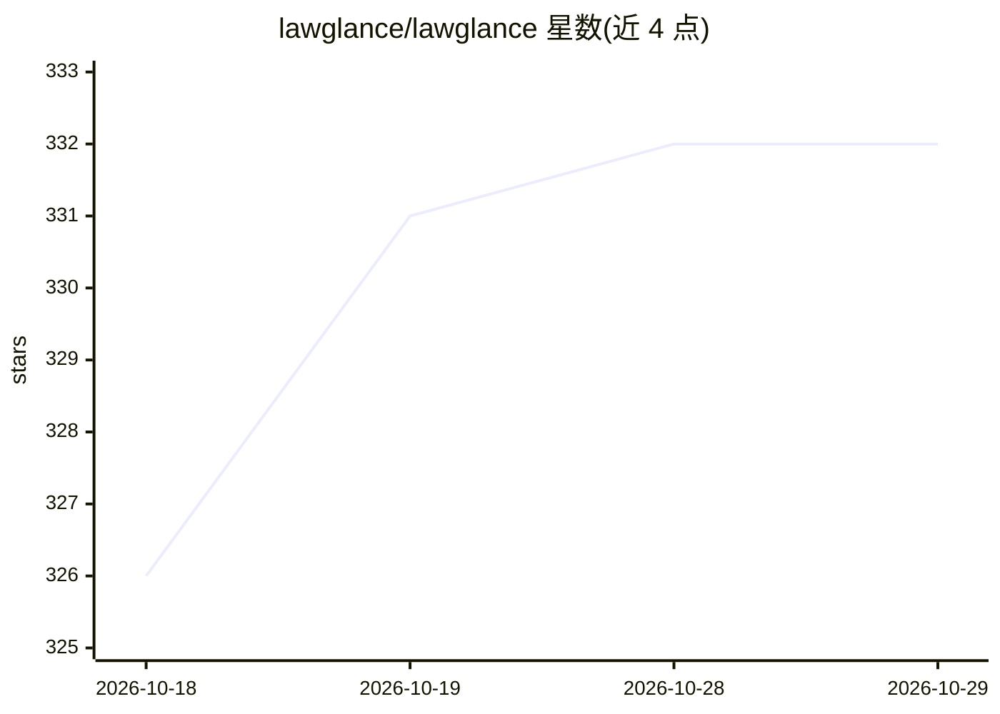

# lawglance/lawglance

⭐ 332 · Jupyter Notebook · Apache-2.0 · 推送 2026-09-21 · [GitHub](https://github.com/lawglance/lawglance) · [官网](https://lawglance.com/) · 组织维护

**面向大众的 RAG 法律问答助手，覆盖印度多部法律**

开源的 AI 法律咨询应用：基于 LangGraph 的 agentic 检索管线，由 agent 自主决定调用向量检索工具（ChromaDB），循环收集上下文后输出带引用的回答；前端为 Streamlit 聊天界面，另有 FastAPI HTTP 后端可独立部署。法律知识库目前覆盖印度宪法及 2023/2019 等多部法规，使用 OpenAI API（需自备 key），Redis 用于缓存聊天与响应（生产推荐）。给普通人和法律从业者获取法律指引使用；原 Niyam SahaAI 更名而来，法律覆盖范围暂限印度。

## 筛选速览

| 维度 | 判定 | 备注 |
|---|---|---|
| AI 角色 | `ai-native` | 本体是模型或模型工具 |
| 许可风险 | `permissive` | Apache-2.0 |
| 部署形态 | `None` |  |
| 模型依赖 | — | README 未给出锁定关系 |
| 硬件要求 | — | 无带数字的原话,不猜 |
| 安装摩擦 | `low` | 无编译、无系统依赖或容器化 |
| 成熟度 | — | 结构信号不足 |

## 能力要点

- LangGraph agent 循环调用 retrieve_docs 工具，输出带引用回答
- Streamlit 聊天界面 + 可独立运行的 FastAPI 后端
- 知识库覆盖印度宪法等 8 部法律
- Redis 缓存聊天历史与 LLM 响应（可选）

## 适用场景

- 以对话方式查询印度法律条文与解释
- 通过 FastAPI 接口将法律问答嵌入其他应用
- 非专业人士获取基础法律指引

## 场景标签

`文档问答` `聊天机器人` · 领域:对话与助手

## 证据(README 行号)

> L17: **LawGlance** is a free, open-source, people-centric initiative 💡 designed to make legal guidance accessible to eve
> L102: **LawGlance** is now powered by an agentic retrieval pipeline built with **LangGraph**, living in the `backend/` f

## 星数曲线

2026-10-18 326 → 2026-10-29 332（+6）

---
*卡片 v1 · prompt 1.4 · 生成 2026-10-21 · 置信度 high · 依据 README sha `51ecb58b343b` · [字段定义](../../DATASET.md)*
