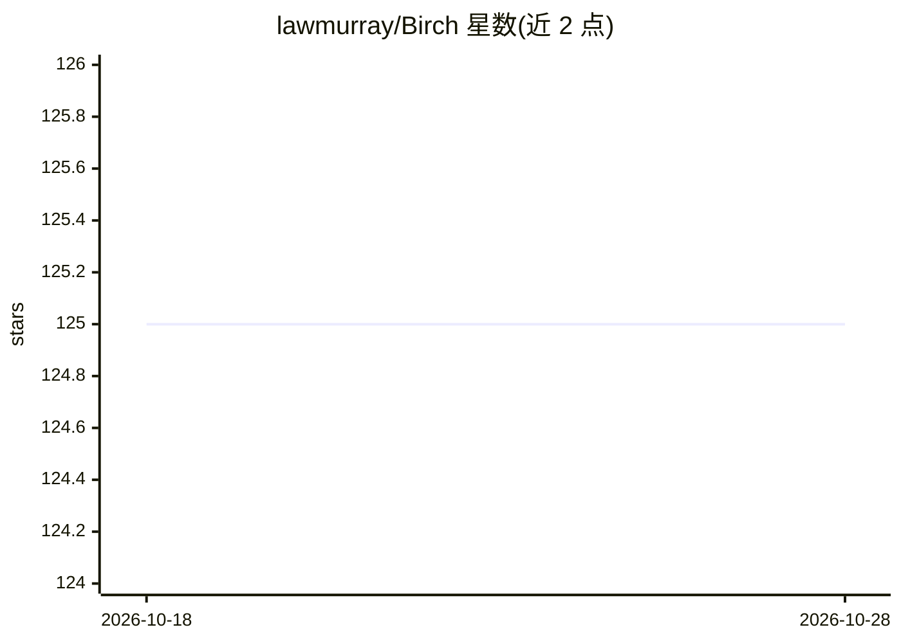

# lawmurray/Birch

⭐ 125 · C++ · Apache-2.0 · 推送 2026-09-26 · [GitHub](https://github.com/lawmurray/Birch) · [官网](https://birch-lang.org) · 个人维护

**面向贝叶斯推断的概率编程语言，转译为 C++**

Birch 是一门概率编程语言，提供自动边缘化、自动条件化与自动微分三项语言级机制，推断算法基于序贯蒙特卡洛（SMC），语言转译为 C++。面向需要编写贝叶斯统计模型并做推断的数据科学/机器学习开发者。安装以源码编译为主：需 GNU autoconf/automake/libtool/flex/bison、LibYAML、Eigen，依次编译安装 MemBirch、NumBirch、Birch 及标准库；jemalloc 为可选性能依赖，CUDA 后端为高级可选构建。采用 Apache 许可证。

## 筛选速览

| 维度 | 判定 | 备注 |
|---|---|---|
| AI 角色 | `ai-native` | 本体是模型或模型工具 |
| 许可风险 | `permissive` | Apache-2.0 |
| 部署形态 | `None` |  |
| 模型依赖 | — | README 未给出锁定关系 |
| 硬件要求 | — | 无带数字的原话,不猜 |
| 安装摩擦 | `high` | 编译与系统依赖俱全 |
| 成熟度 | — | 结构信号不足 |

## 能力要点

- 自动边缘化、自动条件化、自动微分三项语言机制
- 推断基于序贯蒙特卡洛（SMC）
- 语言转译为 C++
- 可选 CUDA 后端与 jemalloc 性能优化

## 适用场景

- 用概率编程语言编写贝叶斯模型并做推断
- 需要自动边缘化/条件化处理的层级贝叶斯建模
- 通过 SMC 做序贯推断研究

## 场景标签

 · 领域:机器学习/贝叶斯统计

## 证据(README 行号)

> L3: Birch is a probabilistic programming language featuring automatic
> L5: inference algorithms based on Sequential Monte Carlo (SMC). The Birch language

## 星数曲线

2026-10-18 125 → 2026-10-28 125（+0）

---
*卡片 v1 · prompt 1.4 · 生成 2026-10-23 · 置信度 high · 依据 README sha `5edc0613c3af` · [字段定义](../../DATASET.md)*
