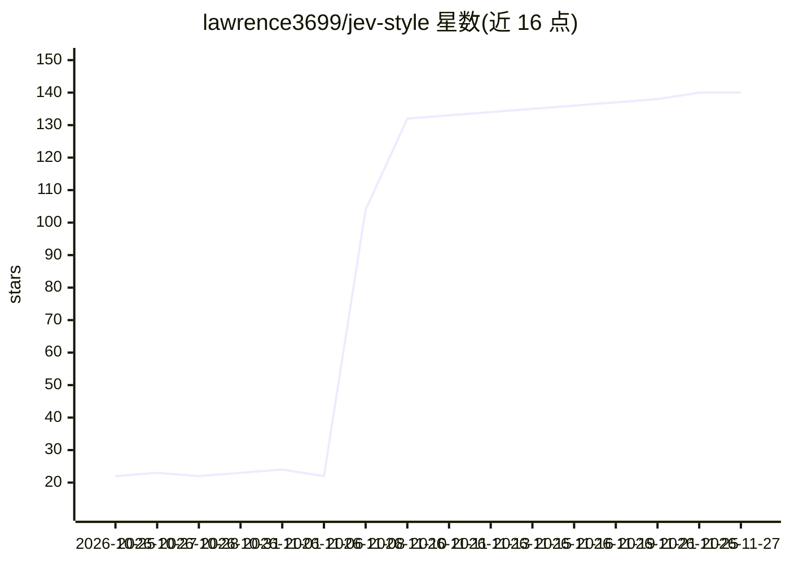

# lawrence3699/jev-style

⭐ 140 · Python · Apache-2.0 · 推送 2026-11-04 · [GitHub](https://github.com/lawrence3699/jev-style) · [官网](https://jevstyle.com) · 个人维护 · 中文 README

**本机运行的小型决策模型工具包：分类/路由/打分并输出概率**

Jev-Style 包含 0.8B 与 2B（基于 Qwen3.5 微调）两个决策模型及配套工具包，输入文本/JSON、可选图像，单次前向传播输出每个选项的校准概率，支持 yes/no、多选（最多 255 项）与有序评分三类问题。提供本地 HTTP 服务器（systemone 兼容接口）、Python 客户端、MCP server、六个 agent 技能与 Claude Code 工具调用守卫。pip 安装，CPU 可运行，无 GPU、API key 或训练需求；图像输入仅 PyTorch 后端支持。

## 筛选速览

| 维度 | 判定 | 备注 |
|---|---|---|
| AI 角色 | `ai-native` | 本体是模型或模型工具 |
| 许可风险 | `permissive` | Apache-2.0 |
| 部署形态 | `library` | 以包/库形式分发 |
| 模型依赖 | local-ok | 支持本地模型 |
| 硬件要求 | `cpu-ok` | |
| 安装摩擦 | `medium` | 含编译或系统依赖之一 |
| 成熟度 | — | 结构信号不足 |

## 能力要点

- 一次前向传播输出每个选项的校准概率（附 held-out 数据拟合的温度参数）
- 0.8B 约 0.53 GB（4-bit）笔记本可跑，数据不出本机
- 2B v4 支持图像输入与 32,768 token 长输入（PyTorch 后端）
- 六个 agent 技能、MCP server 与 Claude Code 工具调用守卫

## 适用场景

- 把客服工单路由到正确的团队
- 让 agent 在本地模型的判断下决定调用哪个工具或模型
- 对邮件做钓鱼检测与话题打标
- 检查收据、截图与扫描表单

## 场景标签

 · 领域:AI 基础设施/决策模型

## 证据(README 行号)

> L3:  Small decision models that run on your own machine. Text and images in, a calibrated probability for every option o
> L23: Jev-Style is a family of small decision models (0.8B and 2B, fine-tuned from Qwen3.5) and the toolkit that puts the
> L71: - **Built for agents.** Six agent skills, an MCP server in the official registry, a Claude Code tool-call guard and

## 星数曲线

2026-10-25 22 → 2026-11-27 140（+118）

---
*卡片 v1 · prompt 1.4 · 生成 2026-11-27 · 置信度 mid · 依据 README sha `ea84f890a81e` · [字段定义](../../DATASET.md)*
