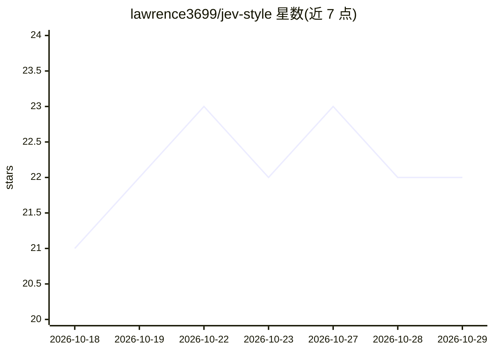

# lawrence3699/jev-style

⭐ 22 · Python · Apache-2.0 · 推送 2026-10-28 · [GitHub](https://github.com/lawrence3699/jev-style) · [官网](https://jevstyle.com) · 个人维护

**本地运行的小型校准决策模型：文本输入返回各选项概率**

基于 Qwen3.5 的 0.8B/2B 决策模型家族及配套工具链。输入文本或 JSON 与带类型的问题（是/否、多选、评分），模型一次前向返回每个选项的校准概率，支持最长 25,600 token。提供本地服务器（MLX/PyTorch/可选 GGUF 后端）、6 个 agent 技能（npx 一键安装）、Claude Code PreToolUse 守卫钩子、MCP 工具（decide/noul/choice/score）与自有标注数据评测命令。无需 GPU、API key 或训练。权重托管于 Hugging Face。

## 筛选速览

| 维度 | 判定 | 备注 |
|---|---|---|
| AI 角色 | `ai-native` | 本体是模型或模型工具 |
| 许可风险 | `permissive` | Apache-2.0 |
| 部署形态 | `library` | 以包/库形式分发 |
| 模型依赖 | local-ok | 支持本地模型 |
| 硬件要求 | — | 无带数字的原话,不猜 |
| 安装摩擦 | `medium` | 含编译或系统依赖之一 |
| 成熟度 | — | 结构信号不足 |

## 能力要点

- 一次前向返回各选项校准概率（noul/choice/score 三种问题类型）
- 本地服务器按机器自动选择 MLX（Apple silicon）或 PyTorch（CUDA/CPU）后端
- 6 个 agent 技能：部署、调用、评测、替换仅返回标签的 LLM 调用、Claude Code 守卫、MCP 注册
- jev-style eval 报告准确率、Brier、ECE 及 1/5/10% 错误预算下可自动化的决策比例

## 适用场景

- 在 agent 工作流中用小模型本地判断工单分类、是否放行工具调用等决策
- 把代码里只返回标签的 LLM 调用替换为本地决策模型，低于置信阈值回退 LLM
- 在自有标注数据上评测决策准确率与校准，确定可自动化的比例

## 场景标签

`模型评测` · 领域:评测与运维

## 证据(README 行号)

> L18: Jev-Style is a family of small decision models built on Qwen3.5. The current releases are Jev-Style-2B-Decision-v3 
> L34: - **Three question types in one request.** Yes/no (`noul`), multiple choice (`choice`, up to 255 options) and order

## 星数曲线

2026-10-18 21 → 2026-10-29 22（+1）

---
*卡片 v1 · prompt 1.4 · 生成 2026-10-27 · 置信度 high · 依据 README sha `24b8f4fe25de` · [字段定义](../../DATASET.md)*
