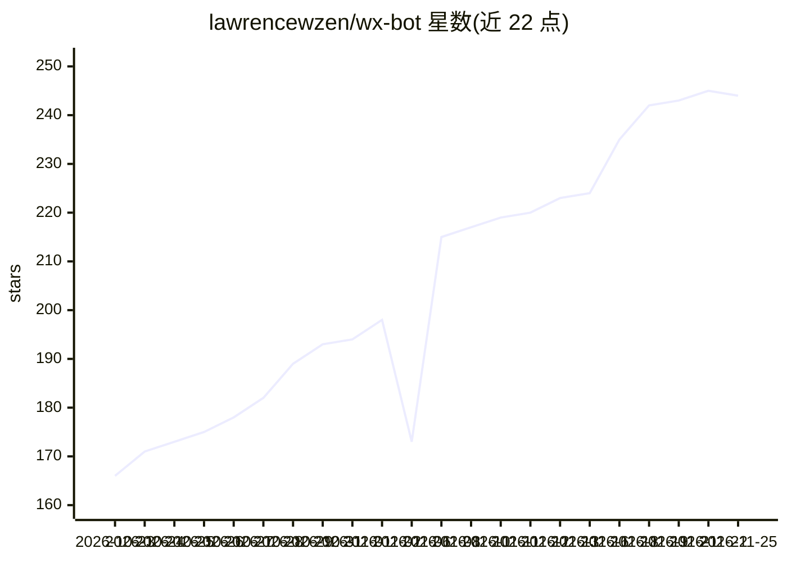

# lawrencewzen/wx-bot

⭐ 244 · TypeScript · MIT · 推送 2026-10-23 · [GitHub](https://github.com/lawrencewzen/wx-bot) · 个人维护 · 中文 README

**把微信消息桥接到个人 AI Agent 的消息通道工具**

基于 TypeScript + Bun 的微信接入工具，消息经腾讯官方 ClawBot / iLink 进入本机落盘到 SQLite 收件箱，再以 webhook 推送或 pull 拉取两种方式投递给用户的 Agent，Agent 通过 wx-bot send 回发微信。只支持本人扫码登录的账号，不支持好友消息；只出站、不对外开端口，本地 API 仅监听 loopback。支持收发文本、图片、语音（带转写）、文件、视频，提供 chatlog 聊天记录留存与重投、升级、回滚等运维命令，支持 Linux / macOS。

## 筛选速览

| 维度 | 判定 | 备注 |
|---|---|---|
| AI 角色 | `ai-ecosystem` | LLM/agent 周边工具 |
| 许可风险 | `permissive` | MIT |
| 部署形态 | `None` |  |
| 模型依赖 | — | README 未给出锁定关系 |
| 硬件要求 | — | 无带数字的原话,不猜 |
| 安装摩擦 | `low` | 无编译、无系统依赖或容器化 |
| 成熟度 | — | 结构信号不足 |

## 能力要点

- SQLite 收件箱先落盘再确认，投递失败自动重投，按 event_id 去重
- webhook 推送与 pull 拉取两种投递模式，本地 API 仅监听 loopback
- 收发文本、图片、语音（带转写）、文件、视频
- 提供 status/chatlog/health/requeue/update 等运维命令

## 适用场景

- 让自己的 AI Agent（如 Grok Bot）收发微信消息
- 给个人微信搭建可靠的消息落盘与重投通道
- 按天留存与检索微信收发记录

## 场景标签

 · 领域:即时通讯/AI Agent 基础设施

## 证据(README 行号)

> L14:  微信消息经腾讯官方 ClawBot / iLink 进入本机 <code>wx-bot</code>，
> L15:  落盘后推送给你的 Agent（webhook）或由 Agent 拉取（pull）；Agent 再用 <code>wx-bot send</code> 发回微信。
> L26: - **两种投递**：`webhook` 推给 Agent，`pull` 由 Agent 来取。

## 星数曲线

2026-10-23 166 → 2026-11-25 244（+78）

---
*卡片 v1 · prompt 1.4 · 生成 2026-11-25 · 置信度 high · 依据 README sha `c6098e2f170d` · [字段定义](../../DATASET.md)*
