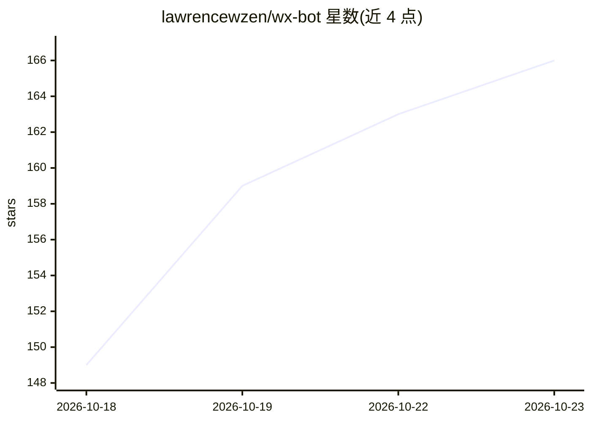

# lawrencewzen/wx-bot

⭐ 166 · TypeScript · MIT · 推送 2026-10-11 · [GitHub](https://github.com/lawrencewzen/wx-bot) · 个人维护 · 中文 README

**把微信消息接入个人 AI Agent 的本地收发桥（TypeScript/Bun）**

运行于 Linux/macOS 本机的微信消息桥：微信消息经腾讯官方 ClawBot/iLink 进入本地 wx-bot，先落盘 SQLite 收件箱再通过 webhook 推送或由 Agent 拉取；Agent 用 wx-bot send 回复微信。支持文本、图片、语音（带转写）、文件、视频，本地 API 仅监听 loopback，默认白名单只处理扫码登录的微信号。提供 install.sh 安装、CLI 运维命令（status/health/update），另支持 Cloudflare Workers 部署方式。仅出站、不开对外端口；微信不渲染 Markdown，回复为纯文本。

## 筛选速览

| 维度 | 判定 | 备注 |
|---|---|---|
| AI 角色 | `ai-ecosystem` | LLM/agent 周边工具 |
| 许可风险 | `permissive` | MIT |
| 部署形态 | `None` |  |
| 模型依赖 | — | README 未给出锁定关系 |
| 硬件要求 | — | 无带数字的原话,不猜 |
| 安装摩擦 | `low` | 无编译、无系统依赖或容器化 |
| 成熟度 | — | 结构信号不足 |

## 能力要点

- 消息先落盘本地 SQLite 收件箱，投递失败自动重投、按 event_id 去重
- webhook 推送与 pull 领取两种投递方式
- 只出站设计：本地 API 仅监听 loopback，默认仅理会扫码登录的微信号
- 支持收发文本/图片/语音（转写）/文件/视频

## 适用场景

- 让我的 Grok/Muse 等 Agent 直接收发微信消息
- 通过微信对话使用个人 AI Agent，无需对外开端口
- 为运行在本机的 Agent 增加微信消息通道

## 场景标签

`聊天机器人` · 领域:对话与助手

## 证据(README 行号)

> L14:  微信消息经腾讯官方 ClawBot / iLink 进入本机 <code>wx-bot</code>，
> L30: WeChat ──iLink──▶ wx-bot (inbox) ──webhook / pull──▶ Agent

## 星数曲线

2026-10-18 149 → 2026-10-23 166（+17）

---
*卡片 v1 · prompt 1.4 · 生成 2026-10-22 · 置信度 high · 依据 README sha `aad59f5f0400` · [字段定义](../../DATASET.md)*
