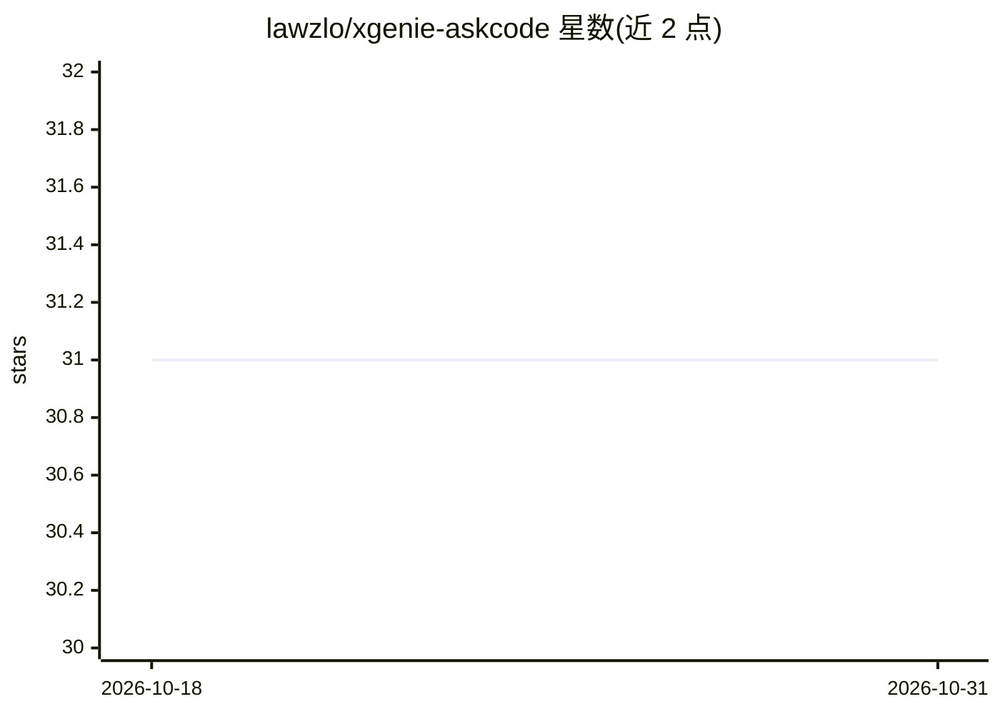

# lawzlo/xgenie-askcode

⭐ 31 · TypeScript · MIT · 推送 2026-05-11 · [GitHub](https://github.com/lawzlo/xgenie-askcode) · [官网](https://askcode.xgenie.co/) · 组织维护

**面向团队的代码库问答应用：用自然语言询问任意 Git 仓库**

基于 Claude agentic loop 的代码库问答 Web 应用：克隆 GitHub/GitLab/Gitea/Bitbucket 仓库后，Claude 自主读取文件、搜索模式、探索结构，以自然语言回答关于代码的问题。面向团队协作场景，提供三级访问控制（开发者/产品/支持），不同级别 Claude 揭露的信息范围不同；支持多仓库合并为一个项目、会话历史保存共享，可自托管。技术栈为 Node.js 18+、Next.js、Supabase（认证与数据库）、Anthropic API key，部署为 app+worker 双服务，需共享 volume 存放克隆的仓库工作区。

## 筛选速览

| 维度 | 判定 | 备注 |
|---|---|---|
| AI 角色 | `ai-native` | 本体是模型或模型工具 |
| 许可风险 | `permissive` | MIT |
| 部署形态 | `self-host` | docker 或自建部署 |
| 模型依赖 | locked-api |  |
| 硬件要求 | — | 无带数字的原话,不猜 |
| 安装摩擦 | `low` | 无编译、无系统依赖或容器化 |
| 成熟度 | — | 结构信号不足 |

## 能力要点

- Claude agentic loop 自主探索代码库后回答问题
- 三级访问控制决定 Claude 对不同角色揭示的信息范围
- 支持 GitHub/GitLab/Gitea/Bitbucket 公私有仓库克隆
- app+worker 双服务架构，worker 后台克隆/同步仓库

## 适用场景

- 新成员接手陌生代码库时用自然语言了解认证流程、数据库结构等
- 产品与支持团队按权限分级获取代码库的非敏感说明
- 团队把多个相关仓库合并为一个项目统一提问

## 场景标签

`文档问答` · 领域:知识与检索

## 证据(README 行号)

> L20: Under the hood, AskCode uses Claude with an agentic loop to explore the codebase - reading files, searching for pat
> L25: - **AI-Powered Q&A** - Claude analyzes code structure and answers questions in plain language

## 星数曲线

2026-10-18 31 → 2026-10-31 31（+0）

---
*卡片 v1 · prompt 1.4 · 生成 2026-10-26 · 置信度 high · 依据 README sha `80e33b60f1c2` · [字段定义](../../DATASET.md)*
