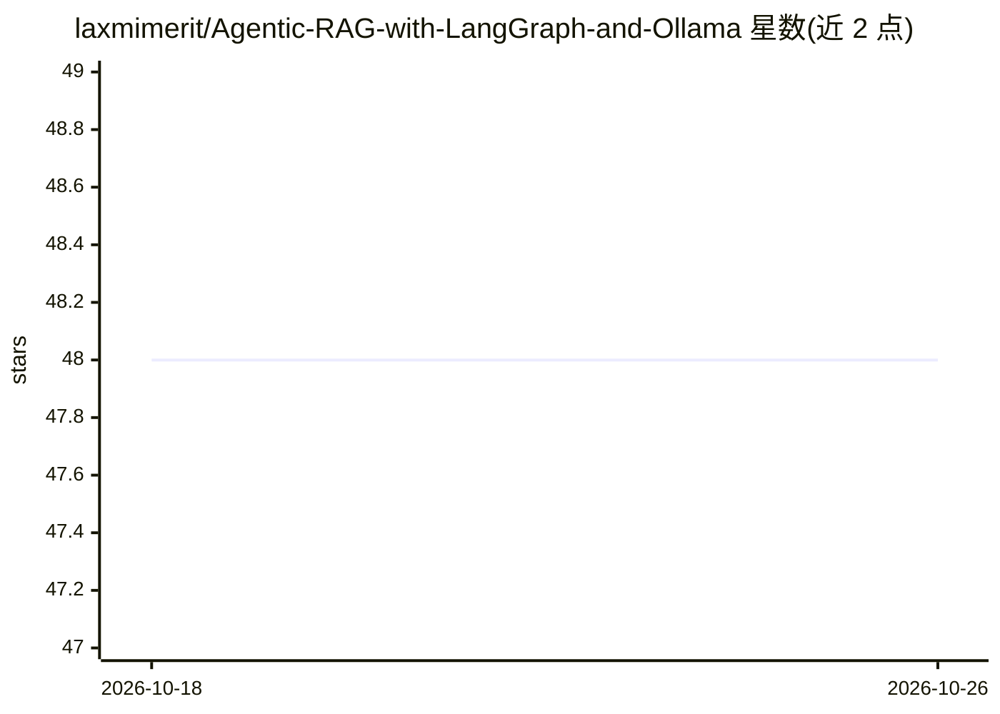

# laxmimerit/Agentic-RAG-with-LangGraph-and-Ollama

⭐ 48 · Jupyter Notebook · 推送 2026-06-18 · [GitHub](https://github.com/laxmimerit/Agentic-RAG-with-LangGraph-and-Ollama) · [官网](https://www.udemy.com/course/agentic-ai-private-agentic-rag-with-langgraph-and-ollama/?referralCode=CF5DEFA2F51FC6A3CAFE) · 组织维护

**AI/ML 付费课程合集页：RAG、Agent、深度学习等方向**

KGP Talkie 维护的 Udemy 课程目录仓库，覆盖 LLM 与 Agent 开发（Agentic RAG、LangChain/LangGraph、Ollama 本地模型、MCP）、机器学习与数据科学（TensorFlow、PyTorch、NLP）、生产部署（FastAPI、Docker、AWS）与数据可视化四类，共约十余门课程条目。每条列出课程内容要点与技术栈，并附 Udemy 推荐链接与学习路径建议。仓库本身为课程营销/导流清单，不含可运行代码。

## 筛选速览

| 维度 | 判定 | 备注 |
|---|---|---|
| AI 角色 | `ai-knowledge` | 知识聚合/清单类 |
| 许可风险 | `none` | — |
| 部署形态 | `None` |  |
| 模型依赖 | — | README 未给出锁定关系 |
| 硬件要求 | — | 无带数字的原话,不猜 |
| 安装摩擦 | `low` | 无编译、无系统依赖或容器化 |
| 成熟度 | — | 结构信号不足 |

## 能力要点

- 收录十余门 AI/ML 付费课程条目，含课程大纲与技术栈说明
- 提供 AI/LLM 开发者、数据科学家、生产工程师等学习路径建议
- 覆盖 Agentic RAG、LangGraph、Ollama、MCP、微调、部署等主题

## 适用场景

- 按学习路径挑选 AI/LLM 或数据科学的付费课程
- 了解 Agentic RAG 与本地 Ollama 模型开发的课程内容范围
- 查找模型生产部署（FastAPI/Docker/AWS）相关课程

## 场景标签

`教程课程` `精选清单` · 领域:学习与行业

## 证据(README 行号)

> L1: # 🚀 Complete AI & Machine Learning Course Collection
> L10: **Master AI Development • Build Production Applications • Deploy at Scale**
> L51:  📊 Agentic RAG with LangChain and LangGraph - Ollama

## 星数曲线

2026-10-18 48 → 2026-10-26 48（+0）

---
*卡片 v1 · prompt 1.4 · 生成 2026-10-25 · 置信度 high · 依据 README sha `a7d1bb7ced59` · [字段定义](../../DATASET.md)*
