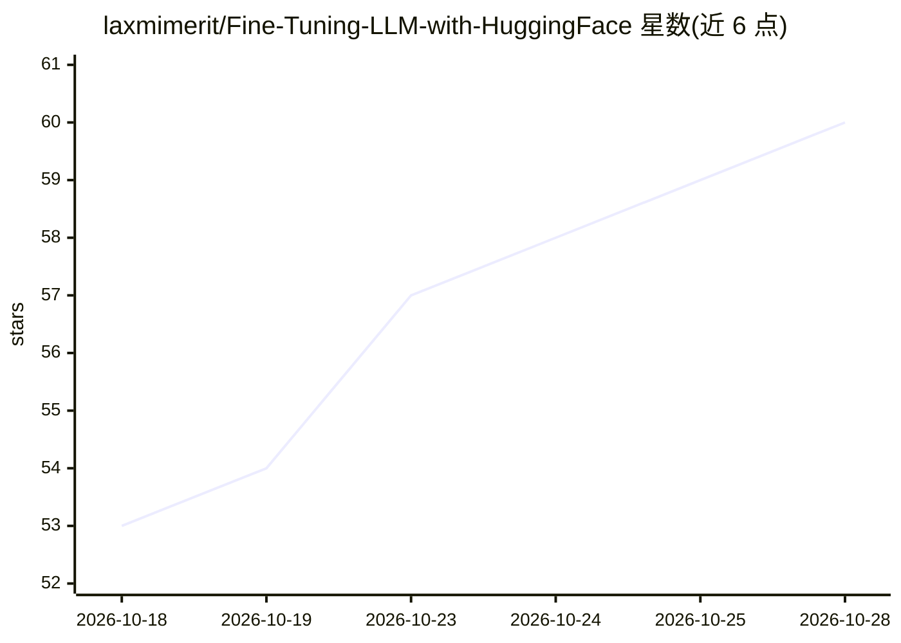

# laxmimerit/Fine-Tuning-LLM-with-HuggingFace

⭐ 60 · Jupyter Notebook · 推送 2026-06-18 · [GitHub](https://github.com/laxmimerit/Fine-Tuning-LLM-with-HuggingFace) · [官网](https://kgptalkie.com/fine-tuning-llm) · 个人维护

**机器学习课程资源清单仓库，含 HuggingFace LLM 微调教程**

一个课程资源汇总仓库：以表格列出多门 Python、机器学习、深度学习与 NLP 课程，其中『Fine Tuning LLM with HuggingFace Transformers for NLP』课程教授用自定义数据集微调 LLM 及 transformers 基础。其余条目覆盖数据可视化、Spacy 3、线性回归、模型部署、R 语言数据科学等主题。README 未提供代码、安装命令或运行说明，仅含课程名称与简介。

## 筛选速览

| 维度 | 判定 | 备注 |
|---|---|---|
| AI 角色 | `ai-knowledge` | 知识聚合/清单类 |
| 许可风险 | `none` | — |
| 部署形态 | `None` |  |
| 模型依赖 | — | README 未给出锁定关系 |
| 硬件要求 | — | 无带数字的原话,不猜 |
| 安装摩擦 | `low` | 无编译、无系统依赖或容器化 |
| 成熟度 | — | 结构信号不足 |

## 能力要点

- 以表格列出 10 余门 ML/DL/NLP 课程及简介
- 包含 HuggingFace Transformers 微调 LLM 的课程条目
- 主题覆盖 Python、TensorFlow、Spacy、模型部署、R 语言

## 适用场景

- 查找机器学习与深度学习入门课程
- 了解 HuggingFace LLM 微调的学习资源
- 按主题浏览 Python 数据科学课程

## 场景标签

`精选清单` `教程课程` · 领域:学习与行业

## 证据(README 行号)

> L4: |ML Course|Description|
> L6: |**Fine Tuning LLM with HuggingFace Transformers for NLP**|Learn how to fine tune LLM with custom dataset. You will 

## 星数曲线

2026-10-18 53 → 2026-10-28 60（+7）

---
*卡片 v1 · prompt 1.4 · 生成 2026-10-24 · 置信度 high · 依据 README sha `f67b448db17f` · [字段定义](../../DATASET.md)*
