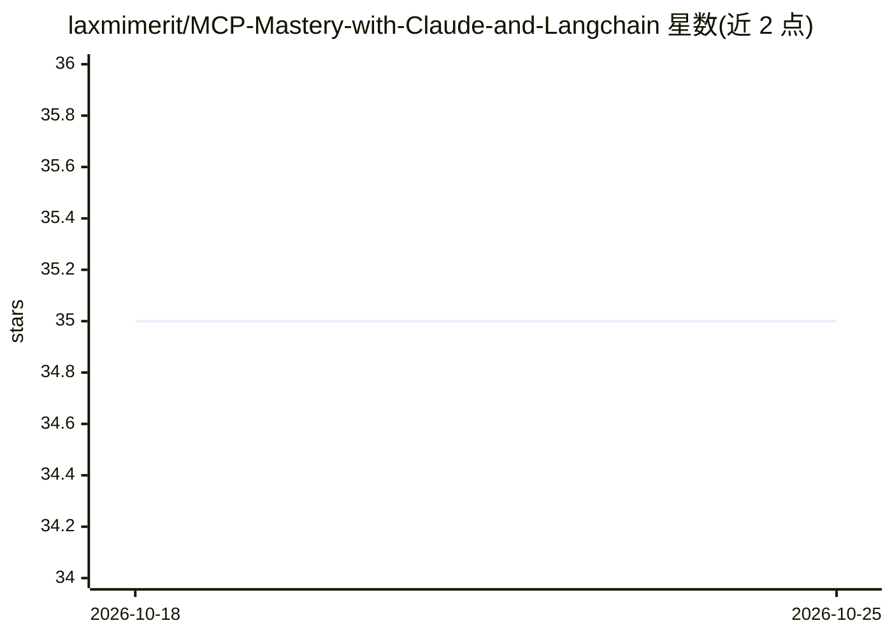

# laxmimerit/MCP-Mastery-with-Claude-and-Langchain

⭐ 35 · HTML · 推送 2026-04-16 · [GitHub](https://github.com/laxmimerit/MCP-Mastery-with-Claude-and-Langchain) · [官网](https://www.udemy.com/course/mcp-mastery-build-ai-apps-with-claude-langchain-and-ollama/?referralCode=31C17C306A59601B8689) · 组织维护

**AI/ML 付费课程合集目录：MCP、LangChain、RAG、深度学习等**

KGP Talkie 维护的 AI 与机器学习课程推广目录，列出 MCP 服务器与客户端开发、Agentic RAG、LangChain/LangGraph、LLM 微调、深度学习、NLP、机器学习基础与生产部署等约 15 门课程，每门附简介、技术栈（Python、Streamlit、ChromaDB、Ollama、Qdrant 等）与付费注册链接。仓库本身不提供代码或软件安装，定位为课程营销入口，面向学习者与开发者。

## 筛选速览

| 维度 | 判定 | 备注 |
|---|---|---|
| AI 角色 | `ai-knowledge` | 知识聚合/清单类 |
| 许可风险 | `none` | — |
| 部署形态 | `None` |  |
| 模型依赖 | — | README 未给出锁定关系 |
| 硬件要求 | — | 无带数字的原话,不猜 |
| 安装摩擦 | `low` | 无编译、无系统依赖或容器化 |
| 成熟度 | — | 结构信号不足 |

## 能力要点

- 覆盖 MCP、Agentic RAG、LangChain/LangGraph agents、LLM 微调等主题的课程条目
- 每门课程列出技术栈与学习要点
- 提供指向 kgptalkie.com 与 Udemy 的注册链接

## 适用场景

- 查找 MCP 或 RAG 相关的系统化课程
- 按技术栈（Ollama、LangChain、Qdrant）筛选 AI 开发教程
- 了解从深度学习基础到生产部署的课程路径

## 场景标签

`精选清单` · 领域:学习与行业

## 证据(README 行号)

> L1: # 🚀 Complete AI & Machine Learning Course Collection
> L30: Enroll Now

## 星数曲线

2026-10-18 35 → 2026-10-25 35（+0）

---
*卡片 v1 · prompt 1.4 · 生成 2026-10-18 · 置信度 high · 依据 README sha `859454c55e64` · [字段定义](../../DATASET.md)*
