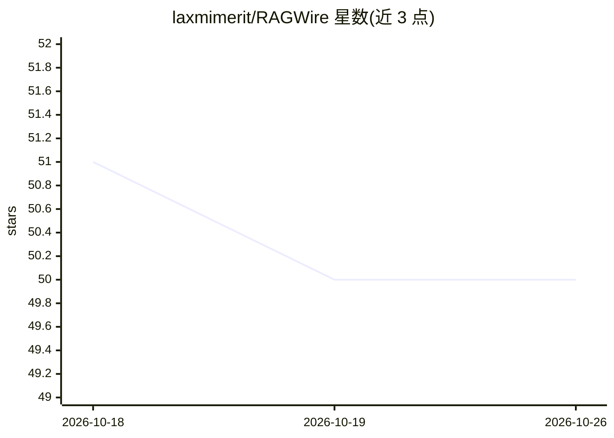

# laxmimerit/RAGWire

⭐ 50 · Python · MIT · 推送 2026-08-14 · [GitHub](https://github.com/laxmimerit/RAGWire) · [官网](https://laxmimerit.github.io/RAGWire/) · 个人维护

**面向开发者的生产级 RAG 工具包：文档摄取、Qdrant 存储与检索**

Python 工具包，用几行代码构建 RAG 管线：经 MarkItDown 摄取 PDF/DOCX/XLSX/PPTX 等文档，SHA256 去重，LLM 抽取结构化元数据，存入 Qdrant 向量库，支持相似度/MMR/混合检索与 cross-encoder 重排；query() 生成带引用的回答且文档不足时拒答。嵌入与 LLM 提供商（Ollama/OpenAI/Anthropic 等）经 YAML 配置切换，可全程本地化运行。提供 CLI（ingest/sync/eval/mcp serve）、评测（recall@k、MRR）与 MCP 服务器接入 Claude Desktop/Cursor。自述处于 beta，API 可能变动。

## 筛选速览

| 维度 | 判定 | 备注 |
|---|---|---|
| AI 角色 | `ai-ecosystem` | LLM/agent 周边工具 |
| 许可风险 | `permissive` | MIT |
| 部署形态 | `self-host` | docker 或自建部署 |
| 模型依赖 | local-ok | 支持本地模型 |
| 硬件要求 | — | 无带数字的原话,不猜 |
| 安装摩擦 | `low` | 无编译、无系统依赖或容器化 |
| 成熟度 | `idea` | |

## 能力要点

- 文档摄取+LLM 元数据抽取+SHA256 文件与分块级去重
- Qdrant 存储，dense/sparse/hybrid 检索与可选 cross-encoder 重排
- 带引用的拒答式回答生成，同步与异步
- recall@k/MRR 评测与配置扫描，CLI 与 MCP 服务器

## 适用场景

- 对 PDF 与 Office 文档建内部知识库做问答
- 财务文档/SEC 文件分析与元数据过滤检索
- 定时同步本地文件夹或 S3 桶保持知识库更新
- 经 MCP 让 Claude Desktop/Cursor 访问自有文档

## 场景标签

`RAG` · 领域:知识与检索

## 证据(README 行号)

> L26: RAGWire gives you the building blocks for document-heavy RAG systems without forcing you into a full application fr
> L298: RAGWire is a composable Python toolkit, not a hosted RAG platform and not a full application framework. Use it whe

## 星数曲线

2026-10-18 51 → 2026-10-26 50（-1）

---
*卡片 v1 · prompt 1.4 · 生成 2026-10-24 · 置信度 mid · 依据 README sha `aeb573b48b92` · [字段定义](../../DATASET.md)*
