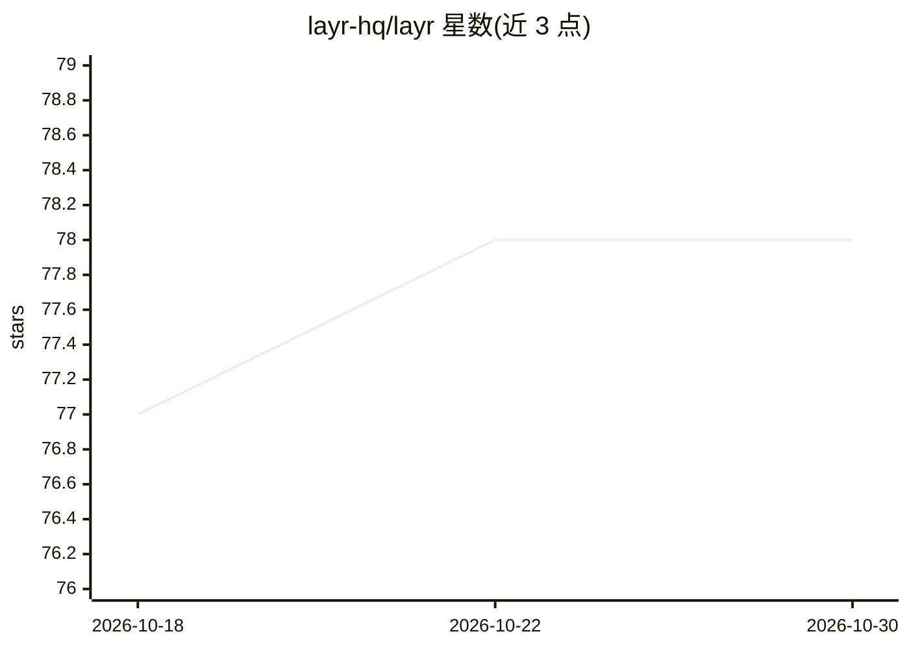

# layr-hq/layr

⭐ 78 · NOASSERTION · 推送 2026-06-18 · [GitHub](https://github.com/layr-hq/layr) · 组织维护

**给 agentic 编程工具的规则化生产系统：把 UX/安全等方法变成可执行约束**

以 Markdown 规则文件构成的模块化系统，供 Claude、Cursor 等 agentic 开发工具读取执行：SYSTEM.md 作为系统内核负责界面类型选择、硬性门禁与方法冲突裁决，按 pricing、onboarding、仪表盘等 7 类 surface playbook 路由，覆盖 UX、设计、无障碍、安全、性能、SEO、CRO、文案等 12 个模块，要求每条建议关联模块/方法/证据，并以评分（≥85）驱动迭代。使用方式为粘贴仓库 URL 提示词或克隆到项目根目录，可选用 layr.config.md 与 screen 简报补充上下文。

## 筛选速览

| 维度 | 判定 | 备注 |
|---|---|---|
| AI 角色 | `ai-ecosystem` | LLM/agent 周边工具 |
| 许可风险 | `none` | NOASSERTION |
| 部署形态 | `None` |  |
| 模型依赖 | — | README 未给出锁定关系 |
| 硬件要求 | — | 无带数字的原话,不猜 |
| 安装摩擦 | `low` | 无编译、无系统依赖或容器化 |
| 成熟度 | — | 结构信号不足 |

## 能力要点

- SYSTEM.md 内核做 surface 选择、硬性门禁与证据约束
- 12 个生产模块（UX/无障碍/安全/性能/SEO/CRO 等）自动按任务选择
- 7 类 surface playbook（pricing/onboarding/仪表盘等）
- 零配置可用：粘贴仓库 URL 提示词即可，评分低于 85 持续修复

## 适用场景

- 让 Claude/Cursor 等 agentic 工具按生产标准构建或改进产品界面
- 对 AI 生成的页面做质量评分与弱项修复
- 为定价页、注册流等关键页面补充上下文以提升精度

## 场景标签

`提示工程` · 领域:Agent 开发

## 证据(README 行号)

> L97: Layr is a rule-based production system for AI-built software.
> L99: It gives agentic tools a structured way to select the right product modules, apply proven methods, score the result
> L338: |`RUN.md`|Main execution entry point for agentic tools|No|

## 星数曲线

2026-10-18 77 → 2026-10-30 78（+1）

---
*卡片 v1 · prompt 1.4 · 生成 2026-10-24 · 置信度 high · 依据 README sha `424d7ee58ad4` · [字段定义](../../DATASET.md)*
