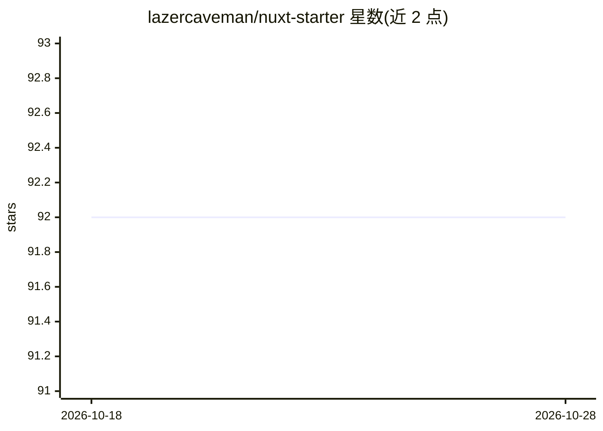

# lazercaveman/nuxt-starter

⭐ 92 · TypeScript · MIT · 推送 2026-10-28 · [GitHub](https://github.com/lazercaveman/nuxt-starter) · [官网](https://alisoueidan.com/blog/nuxt-starter-kit-your-launchpad-for-modern-web-development) · 个人维护

**预配置的 Nuxt 4 项目模板，含工具链与 Claude Code 配置**

基于 Vue 3 的 Nuxt 4 脚手架模板，开箱集成 TypeScript、Vite、Oxlint、Oxfmt、Vitest、Husky、Tailwind CSS + SCSS、Pinia、Storybook 与 Chromatic。AI 相关部分为预配置的 CLAUDE.md 文件：Claude Code 会话在仓库内自动读取该文件，获取技术栈、目录结构、命令与规则说明。提供清理脚本一键移除示例内容，MIT 许可允许商用。使用需 Node v22.13.0 与 yarn。

## 筛选速览

| 维度 | 判定 | 备注 |
|---|---|---|
| AI 角色 | `ai-enhanced` | 去掉 AI 部分产品仍成立 |
| 许可风险 | `permissive` | MIT |
| 部署形态 | `None` |  |
| 模型依赖 | — | README 未给出锁定关系 |
| 硬件要求 | — | 无带数字的原话,不猜 |
| 安装摩擦 | `low` | 无编译、无系统依赖或容器化 |
| 成熟度 | — | 结构信号不足 |

## 能力要点

- 预配置 Oxlint/Oxfmt/Vitest/Husky 等开发工具链
- 预配置 CLAUDE.md 供 Claude Code 会话自动读取项目约定
- Tailwind CSS + SCSS + Pinia 状态管理
- yarn script:cleanup 一键清理示例内容

## 适用场景

- 新起 Nuxt 4 项目时跳过基础配置直接开发
- 搭建带 lint、测试与提交钩子的前端工程
- 在 Claude Code 辅助下按项目约定开发

## 场景标签

 · 领域:Web 前端开发

## 证据(README 行号)

> L9: Get ready to supercharge your development with this fully configured Nuxt 4 Starter Kit! Built on Vue 3, AI ready (i
> L75: This starter ships with a pre-configured `CLAUDE.md` file — the instruction file read by Claude Code (Anthropic's A

## 星数曲线

2026-10-18 92 → 2026-10-28 92（+0）

---
*卡片 v1 · prompt 1.4 · 生成 2026-10-23 · 置信度 high · 依据 README sha `e709d7488ab7` · [字段定义](../../DATASET.md)*
