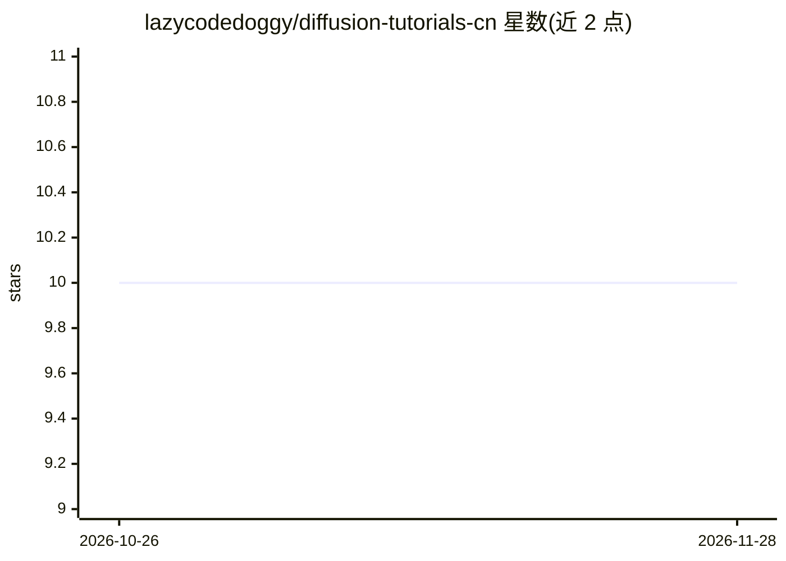

# lazycodedoggy/diffusion-tutorials-cn

⭐ 10 · Jupyter Notebook · MIT · 推送 2026-03-28 · [GitHub](https://github.com/lazycodedoggy/diffusion-tutorials-cn) · 个人维护 · 中文 README

**扩散模型教程中文增强版：打通 DDPM/SMLD/SDE 理论与 PyTorch 实现**

对 tsmatz/diffusion-tutorials 的系统性中文翻译与理论增强版本，保留原始 PyTorch 实现与算法结构。内容以 Jupyter Notebook（逐章中文翻译、可直接运行复现）与独立 Markdown 读书笔记两部分组织，覆盖 VAE/ELBO、DDPM、SMLD、SDE、类别条件扩散、Classifier Guidance 与 CFG。SDE 章节补充 Predictor–Corrector 采样框架与逆时间 SDE 推导，并随仓库提供各章节预训练模型权重（.pt），无 GPU 学习者可直接加载推理。声明为学习研究用途，非官方维护版本。

## 筛选速览

| 维度 | 判定 | 备注 |
|---|---|---|
| AI 角色 | `ai-knowledge` | 知识聚合/清单类 |
| 许可风险 | `permissive` | MIT |
| 部署形态 | `None` |  |
| 模型依赖 | — | README 未给出锁定关系 |
| 硬件要求 | — | 无带数字的原话,不猜 |
| 安装摩擦 | `low` | 无编译、无系统依赖或容器化 |
| 成熟度 | — | 结构信号不足 |

## 能力要点

- DDPM/SMLD/SDE 统一理论框架与代码实现对应
- 7 章 Notebook 中文翻译且可直接运行复现
- 每章配套独立理论读书笔记 Markdown
- 提供各章节预训练 .pt 权重，可跳过训练直接推理

## 适用场景

- 系统学习扩散模型的数学原理与 PyTorch 实现
- 阅读 DDPM/Score-based/SDE 论文时对照代码建立直觉
- 算力受限时加载预训练权重直接体验图像生成
- 用作教学或团队内部分享材料

## 场景标签

`教程课程` · 领域:学习与行业

## 证据(README 行号)

> L7: 本项目是对 Tsuyoshi Matsuzaki（Microsoft）开源项目 **tsmatz/diffusion-tutorials** 的 **系统性中文翻译与理论增强版本**。
> L21: 本仓库适合以下读者：
> L83: ### Notebook：扩散模型理论讲解与实验复现（`.ipynb`）

## 星数曲线

2026-10-26 10 → 2026-11-28 10（+0）

---
*卡片 v1 · prompt 1.4 · 生成 2026-11-19 · 置信度 high · 依据 README sha `56719bba41de` · [字段定义](../../DATASET.md)*
